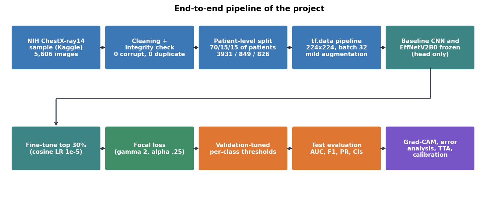
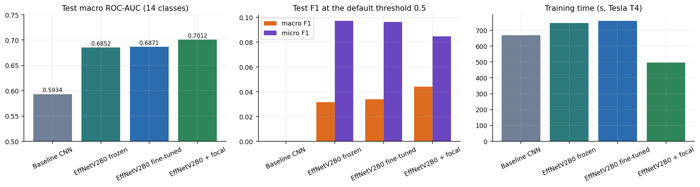
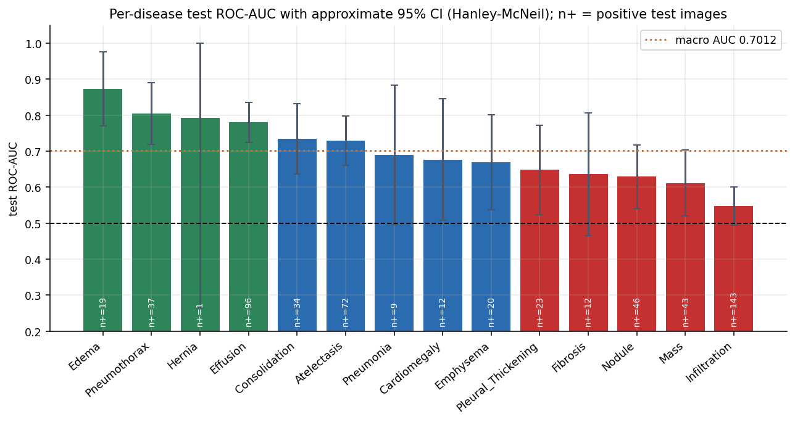
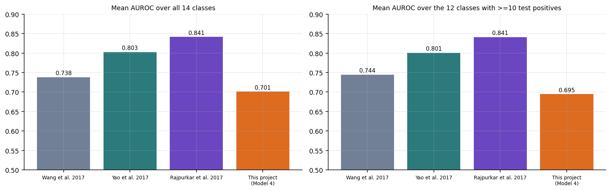
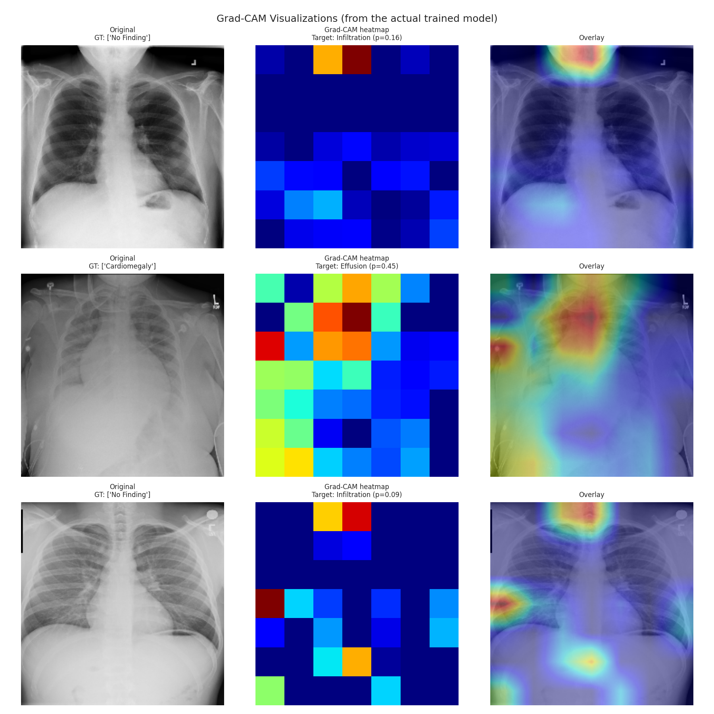
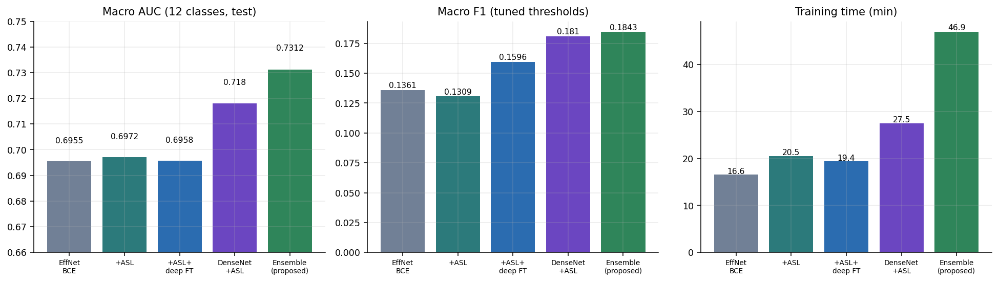

# Multi-Label Chest X-Ray Disease Classification Using EfficientNetV2, Transfer Learning, Fine-Tuning and Explainable AI

| Field | Value |
| :--- | :--- |
| Student | Shhorya Agarwal |
| Registration number | 2430010318 |
| Branch / section | Data Science / D |
| GitHub username | [shhoryaaa](https://github.com/shhoryaaa) |
| Project title | Multi-Label Chest X-Ray Disease Classification Using EfficientNetV2, Transfer Learning, Fine-Tuning and Explainable AI |
| Training programme | Manipal University Jaipur (MUJ) - B.Tech Data Science - Batch F capstone / project training programme (GitHub-based submission) |
| Repository | [MUJ-DS-2430010318](https://github.com/shhoryaaa/MUJ-DS-2430010318) |

<p align="center">


</p>

> **Medical disclaimer.** Educational research project. The model is not a medical device and must not be used for diagnosis or treatment decisions.

## Abstract
A chest X-ray can show several diseases at once. This repository contains an end-to-end, leakage-free deep-learning study of **14-label chest X-ray classification** on a 5,606-image sample of NIH ChestX-ray14: a scratch CNN, a frozen and a fine-tuned EfficientNetV2B0, a focal-loss variant, validation-tuned per-disease thresholds, Grad-CAM explanations, error/calibration/TTA diagnostics, a CO5 ablation (asymmetric loss, deeper fine-tuning, DenseNet121 + EfficientNetV2B0 ensemble) and a CO4 comparison with CheXNet, Yao et al. and Wang et al.

## Results at a glance
| Quantity | Value |
|:---|---:|
| Images used / patients | 5,606 / 4,230 |
| Train / validation / test images | 3,931 / 849 / 826 (patient-level, zero overlap) |
| Final model | EfficientNetV2B0, fine-tuned, focal loss (Model 4) |
| Test macro ROC-AUC (14 diseases) | **0.7012** (micro ROC-AUC 0.7974) |
| Test macro F1 at threshold 0.5 -> validation-tuned thresholds | 0.0442 -> **0.1526** (micro F1 0.0848 -> 0.2101) |
| Gain over the from-scratch baseline CNN (macro AUC) | +0.1078 (0.5934 -> 0.7012) |
| Best / weakest disease by AUC | Edema (0.873) / Infiltration (0.547) |
| Innovation (CO5): two-backbone ensemble, 12-class macro AUC | 0.7312 versus 0.6955 for the single-model reference |
| Published reference (CheXNet, full dataset), mean AUROC | 0.8414 |

**Honest reading of the results.** The model is clearly better than chance (macro AUC 0.70) and transfer learning is the single biggest improvement over a scratch CNN, but it is far from clinical quality: at validation-tuned thresholds the macro precision is only 0.12 and the macro F1 only 0.15, and published models trained on the full 112,120-image dataset reach a mean AUROC of about 0.84. All numbers are measured on a single patient-level test split of 826 images and a single training seed.

<table>
<tr><td align="center" width="50%"><br><sub>End-to-end pipeline: data -> split -> models -> thresholds -> evaluation -> explainability</sub></td><td align="center" width="50%"><br><sub>Comparison of the four main models on the test set</sub></td></tr>
<tr><td align="center" width="50%"><br><sub>Per-disease ROC-AUC on the test set; error bars are approximate 95% confidence intervals</sub></td><td align="center" width="50%"><br><sub>Mean AUROC of published methods and this project</sub></td></tr>
<tr><td align="center" width="50%"><br><sub>Grad-CAM heat-maps on test images, target = top predicted class (cell 24)</sub></td><td align="center" width="50%"><br><sub>Innovation ablation: effect of ASL, deeper fine-tuning and the two-backbone ensemble</sub></td></tr>
</table>

### Model comparison (test set)
| Model | Subset acc. | Macro prec. | Macro recall | Macro F1 | Micro F1 | Macro ROC-AUC | Train time (s) |
| :--- | ---: | ---: | ---: | ---: | ---: | ---: | ---: |
| Model 1: Baseline CNN (scratch) | 0.8630 | 0.8020 | 0.1200 | 0.0284 | 0.0385 | 0.0934 | 667.5 |
| Model 2: EfficientNetV2B0 transfer (frozen) | 0.9375 | 0.1248 | 0.0211 | 0.0317 | 0.0973 | 0.6852 | 744.4 |
| Model 3: EfficientNetV2B0 fine-tuned | 0.9339 | 0.1205 | 0.0225 | 0.0339 | 0.0964 | 0.6871 | 759.4 |
| Model 4: EfficientNetV2B0 fine-tuned + focal loss | 0.9496 | 0.1721 | 0.0271 | 0.0442 | 0.0848 | 0.7012 | 497.1 |

### Best and worst diseases (ROC-AUC, 95% CI)
| Disease | ROC-AUC | 95% CI | Test + |
| :--- | ---: | ---: | ---: |
| Edema | 0.8726 | 0.770 - 0.975 | 19 |
| Pneumothorax | 0.8041 | 0.718 - 0.890 | 37 |
| Hernia | 0.7927 | 0.264 - 1.000 | 1 |
| Nodule | 0.6288 | 0.540 - 0.717 | 46 |
| Mass | 0.6110 | 0.519 - 0.703 | 43 |
| Infiltration | 0.5467 | 0.494 - 0.600 | 143 |

## Repository map
| Path | Content |
|:---|:---|
| [`assignments/dl-project/`](assignments/dl-project/README.md) | full project README (22 sections), [CO3-CO5 evidence map](assignments/dl-project/CO_MAPPING.md), results CSVs, 34 figures, model metadata |
| [`capstone/`](capstone/README.md) | project report, methodology, experiments, limitations and ethics, future work, reproducibility checklist |
| [`code/`](code/README.md) | modular source code, unit tests, requirements, [run guide](code/RUN_GUIDE.md) |
| [`notebooks/`](notebooks/README.md) | link and cell map of the executed Colab notebook |
| [`presentations/`](presentations/README.md) | slide deck and demo script |
| [`resources/`](resources/README.md) | dataset information, references, glossary, machine-readable results |
| [`INSTALLATION.md`](INSTALLATION.md), [`PROJECT_STRUCTURE.md`](PROJECT_STRUCTURE.md), [`SUBMISSION_CHECKLIST.md`](SUBMISSION_CHECKLIST.md) | setup, full file tree, guideline-by-guideline compliance |

## Course outcomes
| CO | Marks | Evidence |
|:---|:---|:---|
| CO3 apply | 10 | complete pipeline on real data, evaluation and explainability: [README sections 3-13](assignments/dl-project/README.md#3-dataset-and-exploratory-analysis) |
| CO4 SOTA comparison | 5 | [README section 15](assignments/dl-project/README.md#15-comparison-with-published-methods-co4), [`sota_comparison.csv`](assignments/dl-project/results/sota_comparison.csv) |
| CO5 innovation | 5 | [README section 14](assignments/dl-project/README.md#14-innovation-and-ablation-co5), [`ablation.csv`](assignments/dl-project/results/ablation.csv) |

## Capstone guideline compliance (30 marks)
| Criterion | Marks | Where to look |
|:---|:---|:---|
| Project implementation and functionality | 10 | [`code/`](code/README.md), [`assignments/dl-project/`](assignments/dl-project/README.md), [results](assignments/dl-project/results/README.md) |
| Individual contribution (commits, issues, pull requests, documentation) | 8 | [commit history](https://github.com/shhoryaaa/MUJ-DS-2430010318/commits/main), [issues](https://github.com/shhoryaaa/MUJ-DS-2430010318/issues?q=is%3Aissue), [pull requests](https://github.com/shhoryaaa/MUJ-DS-2430010318/pulls?q=is%3Apr) |
| Repository organisation and documentation | 4 | every folder has a README; [`PROJECT_STRUCTURE.md`](PROJECT_STRUCTURE.md) |
| Presentation and demonstration | 4 | [`presentations/`](presentations/README.md) |
| Innovation and problem solving | 4 | [CO5 ablation](assignments/dl-project/README.md#14-innovation-and-ablation-co5) |

## GitHub workflow evidence
* [#1](https://github.com/shhoryaaa/MUJ-DS-2430010318/issues/1) - Dataset Collection: acquire and audit the NIH ChestX-ray14 sample
* [#2](https://github.com/shhoryaaa/MUJ-DS-2430010318/issues/2) - Model Development: baseline CNN, EfficientNetV2B0 transfer learning, fine-tuning, focal loss
* [#3](https://github.com/shhoryaaa/MUJ-DS-2430010318/issues/3) - Testing: patient-level evaluation, thresholds, error analysis, TTA, unit tests
* [#4](https://github.com/shhoryaaa/MUJ-DS-2430010318/issues/4) - Documentation: READMEs, report, CO mapping, figures
* [#5](https://github.com/shhoryaaa/MUJ-DS-2430010318/issues/5) - Deployment: packaged inference script and run guide
* [#6](https://github.com/shhoryaaa/MUJ-DS-2430010318/issues/6) - CO4: comparison with published methods (CheXNet, Yao, Wang)
* [#7](https://github.com/shhoryaaa/MUJ-DS-2430010318/issues/7) - CO5: innovation ablation (ASL, deeper fine-tuning, DenseNet121 ensemble)
* Team capstone repository: <https://github.com/shhoryaaa/MUJ-DS-2430010318/tree/main/capstone>
Work was organised with labelled issues, a feature branch per update and merged pull requests; see the [pull requests](https://github.com/shhoryaaa/MUJ-DS-2430010318/pulls?q=is%3Apr).

## Quick start
```bash
git clone https://github.com/shhoryaaa/MUJ-DS-2430010318.git && cd MUJ-DS-2430010318
pip install -r code/requirements.txt
python -m unittest discover -s code/tests -v
```
Full instructions: [`INSTALLATION.md`](INSTALLATION.md) and [`code/RUN_GUIDE.md`](code/RUN_GUIDE.md).

## Honest limitations (short)
5.6k-image sample; single seed and split; weak report-derived labels; macro precision 0.12 at tuned thresholds; far below CheXNet (0.8414 vs 0.7012 mean AUROC). See [`capstone/LIMITATIONS_AND_ETHICS.md`](capstone/LIMITATIONS_AND_ETHICS.md).

## Citation and acknowledgements
Dataset: Wang et al., CVPR 2017 (NIH Clinical Center). Methods: Rajpurkar et al. 2017; Tan and Le 2021; Lin et al. 2017; Ridnik et al. 2021; Selvaraju et al. 2017. Full list in [`resources/README.md`](resources/README.md).
