# Multi-Label Chest X-Ray Disease Classification Using EfficientNetV2, Transfer Learning, Fine-Tuning and Explainable AI

| Field | Value |
| :--- | :--- |
| Student | Shhorya Agarwal |
| Registration number | 2430010318 |
| Branch / section | Data Science / D |
| Batch | Batch F |
| GitHub username | [shhoryaaa](https://github.com/shhoryaaa) |
| Project title | Multi-Label Chest X-Ray Disease Classification Using EfficientNetV2, Transfer Learning, Fine-Tuning and Explainable AI |
| Training programme | Manipal University Jaipur (MUJ) - B.Tech Data Science - Batch F capstone / project training programme (GitHub-based submission) |
| Repository | [MUJ-DS-2430010318](https://github.com/shhoryaaa/MUJ-DS-2430010318) |

**Quick navigation:** [1 Summary](#1-executive-summary) | [2 Problem](#2-problem-statement-and-motivation) | [3 Data](#3-dataset-and-exploratory-analysis) | [4 Preparation](#4-data-preparation-and-patient-level-split) | [5 Augmentation](#5-preprocessing-and-augmentation) | [6 Models](#6-models-and-architecture) | [7 Training](#7-training-protocol-and-curves) | [8 Comparison](#8-model-comparison) | [9 Per disease](#9-per-disease-results) | [10 Thresholds](#10-threshold-optimisation) | [11 Errors](#11-confusion-matrices-and-error-analysis) | [12 Grad-CAM](#12-explainability-with-grad-cam) | [13 Calibration and TTA](#13-calibration-and-test-time-augmentation) | [14 Innovation](#14-innovation-and-ablation-co5) | [15 SOTA](#15-comparison-with-published-methods-co4) | [16 Discussion](#16-discussion) | [17 Limitations](#17-limitations-and-threats-to-validity) | [18 Future work](#18-future-work) | [19 Reproducibility](#19-reproducibility) | [20 Files](#20-file-index) | [21 Glossary](#21-glossary) | [22 References](#22-references)

> **Medical disclaimer.** Educational research project. The model is not a medical device and must not be used for diagnosis or treatment decisions.

---

## 1. Executive summary

This project builds, trains and critically evaluates a **multi-label chest X-ray classifier** that predicts, for every radiograph, the presence of each of 14 thoracic findings. Four models are trained on a patient-level split of a 5,606-image sample of the NIH ChestX-ray14 dataset: a from-scratch baseline CNN, a frozen EfficientNetV2B0 (transfer learning), the same network fine-tuned, and a fine-tuned network trained with focal loss to counter the extreme label imbalance. Per-disease decision thresholds are tuned on the validation split only. The final model is explained with Grad-CAM, stress-tested with an error analysis, test-time augmentation and calibration plots, and compared with published work (CheXNet, Wang et al., Yao et al.). An ablation study (asymmetric loss, deeper fine-tuning, DenseNet121 + EfficientNetV2B0 ensemble) forms the innovation component.

| Quantity | Value |
|:---|---:|
| Images used / patients | 5,606 / 4,230 |
| Train / validation / test images | 3,931 / 849 / 826 (patient-level, zero overlap) |
| Final model | EfficientNetV2B0, fine-tuned, focal loss (Model 4) |
| Test macro ROC-AUC (14 diseases) | **0.7012** (micro ROC-AUC 0.7974) |
| Test macro F1 at threshold 0.5 -> validation-tuned thresholds | 0.0442 -> **0.1526** (micro F1 0.0848 -> 0.2101) |
| Gain over the from-scratch baseline CNN (macro AUC) | +0.1078 (0.5934 -> 0.7012) |
| Best / weakest disease by AUC | Edema (0.873) / Infiltration (0.547) |
| Innovation (CO5): two-backbone ensemble, 12-class macro AUC | 0.7312 versus 0.6955 for the single-model reference |
| Published reference (CheXNet, full dataset), mean AUROC | 0.8414 |

**Honest reading of the results.** The model is clearly better than chance (macro AUC 0.70) and transfer learning is the single biggest improvement over a scratch CNN, but it is far from clinical quality: at validation-tuned thresholds the macro precision is only 0.12 and the macro F1 only 0.15, and published models trained on the full 112,120-image dataset reach a mean AUROC of about 0.84. All numbers are measured on a single patient-level test split of 826 images and a single training seed.

 split -> models -> thresholds -> evaluation -> explainability"> <em>End-to-end pipeline: data -> split -> models -> thresholds -> evaluation -> explainability</em>

### How this document maps to the course outcomes

| Outcome | What it asks | Where it is answered |
|:---|:---|:---|
| **CO3 - apply** (implementation, 10 marks) | a complete, working deep-learning pipeline on real data | sections 3-13 and the [`code/`](../../code/README.md) package |
| **CO4 - state-of-the-art comparison** (5 marks) | compare with published methods and discuss the gap | [section 15](#15-comparison-with-published-methods-co4) and [`CO_MAPPING.md`](CO_MAPPING.md) |
| **CO5 - innovation** (5 marks) | a justified improvement tested by experiment | [section 14](#14-innovation-and-ablation-co5) and [`CO_MAPPING.md`](CO_MAPPING.md) |

---

## 2. Problem statement and motivation

Chest radiography is the most common imaging examination in the world, and reading it is slow, subjective and error-prone, particularly for subtle findings such as nodules or small pneumothoraces. An automatic second reader that flags *which* of several conditions might be present could help prioritise worklists. The task is hard for three reasons that shape every design decision in this repository:

1. **It is multi-label.** Findings co-occur (effusion with atelectasis, cardiomegaly with edema), so the output layer has 14 independent sigmoid units and the loss is a sum of binary losses instead of a softmax cross-entropy.
2. **It is extremely imbalanced.** In the sample the most frequent disease (Infiltration) is present in 17.25% of images, while Hernia is present in 0.23% (13 images in total, 1 of them in the test split). 54.3% of the images carry no finding at all.
3. **Labels are noisy.** The NIH labels were extracted from radiology reports by text mining, not assigned by radiologists looking at the pixels, so some disagreement between image and label is unavoidable.

**Objective.** Build a transfer-learning pipeline on EfficientNetV2B0 that detects the 14 findings, handles the imbalance explicitly, selects decision thresholds without touching the test set, explains its predictions with Grad-CAM, and honestly quantifies how far it is from published systems.

---

## 3. Dataset and exploratory analysis

| Property | Value |
|:---|:---|
| Source | NIH ChestX-ray14, Kaggle sample `nih-chest-xrays/sample` (version 4), obtained with `kagglehub` |
| Images / unique patients | 5,606 / 4,230 (all metadata rows matched an image file, 0 dropped) |
| Image format | 1024 x 1024 PNG (20 randomly inspected files all had this size); metadata records original widths between 2,500 and 3,056 pixels |
| Labels | 14 findings plus "No Finding" (encoded as all 14 outputs equal to 0) |
| Patient sex | 3,134 male, 2,472 female |
| No-finding images | 3,044 (54.3%) |
| Corrupted / duplicate rows | 0 / 0 (every file opened successfully during the integrity pass) |

The complete NIH dataset has 112,120 images (about 42 GB). That does not fit the free Colab disk and time budget, so the official Kaggle **sample** is used. It keeps the same CSV schema, the same 14 labels and the patient identifiers, so every technique used here transfers unchanged to the full data; only the amount of evidence is smaller.

| Disease | Train + | Val + | Test + | Total + | Prevalence | Neg : pos (train) |
| :--- | ---: | ---: | ---: | ---: | ---: | ---: |
| Atelectasis | 364 | 72 | 72 | 508 | 9.06% | 9.8 |
| Cardiomegaly | 110 | 19 | 12 | 141 | 2.52% | 34.7 |
| Effusion | 459 | 89 | 96 | 644 | 11.49% | 7.6 |
| Infiltration | 674 | 150 | 143 | 967 | 17.25% | 4.8 |
| Mass | 195 | 46 | 43 | 284 | 5.07% | 19.2 |
| Nodule | 211 | 56 | 46 | 313 | 5.58% | 17.6 |
| Pneumonia | 43 | 10 | 9 | 62 | 1.11% | 90.4 |
| Pneumothorax | 193 | 41 | 37 | 271 | 4.83% | 19.4 |
| Consolidation | 161 | 31 | 34 | 226 | 4.03% | 23.4 |
| Edema | 83 | 16 | 19 | 118 | 2.10% | 46.4 |
| Emphysema | 88 | 19 | 20 | 127 | 2.27% | 43.7 |
| Fibrosis | 57 | 15 | 12 | 84 | 1.50% | 68.0 |
| Pleural_Thickening | 115 | 38 | 23 | 176 | 3.14% | 33.2 |
| Hernia | 10 | 2 | 1 | 13 | 0.23% | 392.1 |

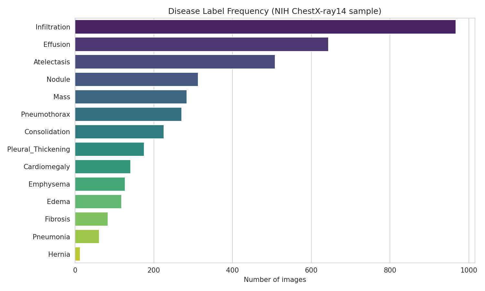 <em>Disease label frequency across the 5,606-image sample (notebook cell 5)</em>

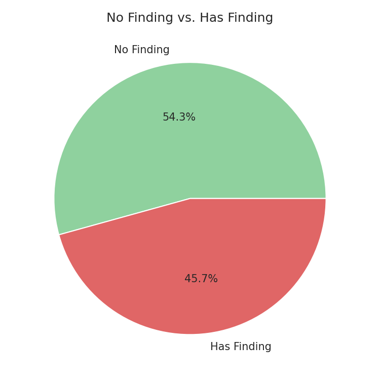 <em>Share of images with no finding versus at least one finding (cell 5)</em>

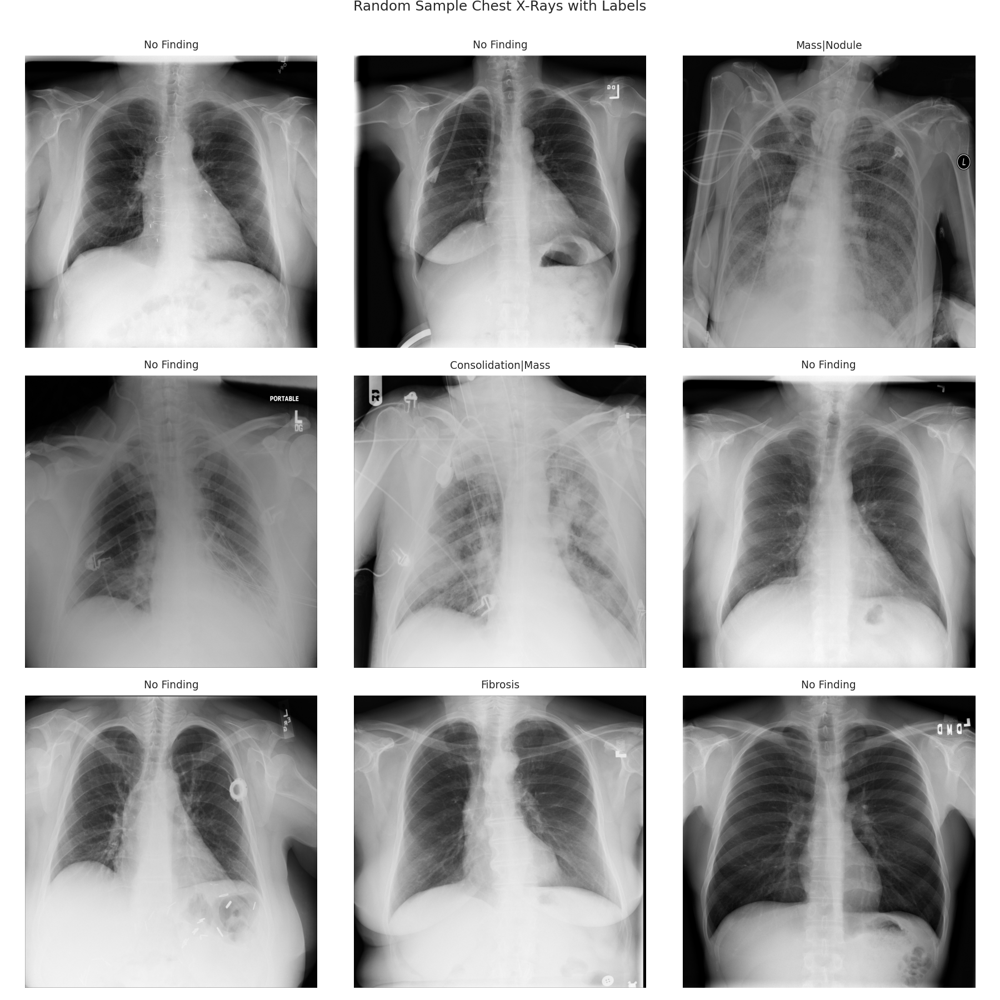 <em>Random sample of chest X-rays with their original multi-label annotations (cell 5)</em>

**What the exploration tells us.** (i) A model that always answers "no disease" would already be right on 56.3% of the test images, so plain accuracy is a misleading yardstick. (ii) 9 of the 14 findings have fewer than 5% positive images, and 5 have fewer than 2.5%; for them a handful of test positives decides the metric, which is why confidence intervals are reported in section 9. (iii) Findings overlap visually (infiltration, consolidation and atelectasis are all hazy opacities), so label noise and class confusion are expected.

 <em>Negative-to-positive ratio per disease in the training split (log scale)</em>

---

## 4. Data preparation and patient-level split

1. **Cleaning.** Duplicate rows were checked (0 found), every image file was opened to detect corruption (0 found), and the multi-label string `Finding Labels` (for example `Cardiomegaly|Emphysema`) was parsed into 14 binary columns.
2. **Patient-level split.** The same patient may appear in several follow-up X-rays. A random *image* split would let a patient's earlier film sit in training and the later film in testing, which inflates performance because the network can memorise patient-specific anatomy. Therefore the 4,230 patient identifiers were shuffled with `RandomState(42)` and cut 70 / 15 / 15 **by patient**. The notebook asserts that the three patient sets are pairwise disjoint (the check passed).
3. **Size cap.** A cap of 6,000 images was defined to keep Colab runs short; with 5,606 images it never removed anything.

| Split | Images | Patients | Share of images |
| :--- | ---: | ---: | ---: |
| train | 3931 | 2961 | 70.1% |
| val | 849 | 634 | 15.1% |
| test | 826 | 635 | 14.7% |
| **total** | 5606 | 4230 | 100% |

 <em>Split sizes (patient-level) and the share of images without findings</em>

 <em>Positive counts per disease in train / validation / test (log scale)</em>

---

## 5. Preprocessing and augmentation

* Images are resized to **224 x 224**, converted to 3 channels, cast to `float32` in the range 0-255 and fed through a `tf.data` pipeline with batching (32) and prefetching. EfficientNetV2 rescales internally, so no external normalisation is applied for it; the baseline CNN contains its own `Rescaling` layer.
* Augmentation is applied to the **training split only** and is deliberately mild: rotation up to about 7 degrees, 5% translation, 5% zoom, brightness +-0.1 and contrast 0.9-1.1. These mimic real variation in patient positioning and exposure.
* **Horizontal flips are not used.** The heart sits on the left, so a flipped film depicts an anatomy (and some laterality-dependent findings) that does not occur in this population and could teach wrong priors.
* The augmentation layers are created once outside the `tf.function`, because creating Keras layers inside the mapped function raises a TensorFlow variable-creation error (a bug fixed during development).

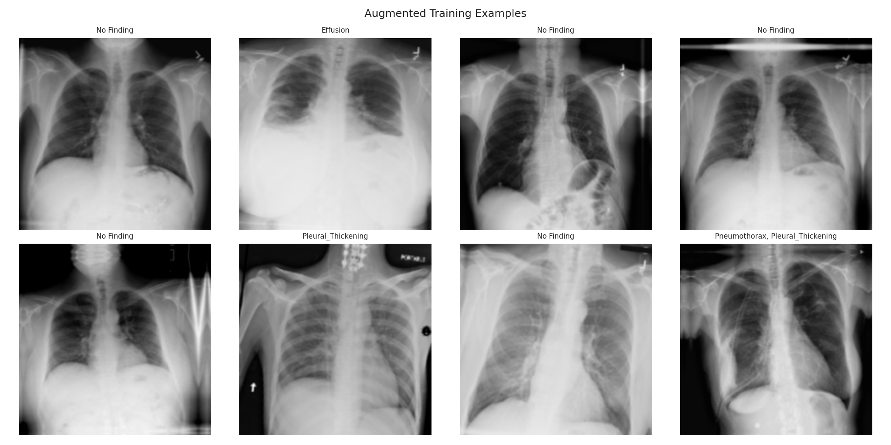 <em>Augmented training examples: small rotation, shift, zoom, brightness and contrast (cell 9)</em>

---

## 6. Models and architecture

Four models were trained, each answering a specific question:

| # | Model | Question it answers |
|:---|:---|:---|
| 1 | Baseline CNN trained from scratch | How far does a small network get without pre-training? |
| 2 | EfficientNetV2B0, ImageNet weights, backbone frozen | How much does transfer learning alone help? |
| 3 | Model 2 + fine-tuning of the top 30% of the backbone | Does adapting the features to radiographs help? |
| 4 | Model 3 + binary focal loss | Does down-weighting easy negatives help with the imbalance? |

### 6.1 Baseline CNN (95,950 parameters)

| Layer | Output shape | Parameters |
| :--- | :--- | ---: |
| input + Rescaling | (224, 224, 3) | 0 |
| Conv2D 32 + BatchNorm + ReLU | (224, 224, 32) | 896 + 128 |
| MaxPool + Dropout | (112, 112, 32) | 0 |
| Conv2D 64 + BatchNorm + ReLU | (112, 112, 64) | 18,496 + 256 |
| MaxPool + Dropout | (56, 56, 64) | 0 |
| Conv2D 128 + BatchNorm + ReLU | (56, 56, 128) | 73,856 + 512 |
| MaxPool + Dropout | (28, 28, 128) | 0 |
| GlobalAveragePooling2D + Dropout | (128) | 0 |
| Dense 14 (sigmoid) | (14) | 1,806 |
| **total** |  | **95,950** |

### 6.2 EfficientNetV2B0 classifier (5,942,366 parameters)

| Layer | Output shape | Parameters |
| :--- | :--- | ---: |
| input_image | (224, 224, 3) | 0 |
| efficientnetv2-b0 (ImageNet weights) | (7, 7, 1280) | 5,919,312 |
| gap: GlobalAveragePooling2D | (1280) | 0 |
| bn_head: BatchNormalization | (1280) | 5,120 |
| dropout_head: Dropout(0.3) | (1280) | 0 |
| dense_head: Dense 14 (sigmoid) | (14) | 17,934 |
| **total** |  | **5,942,366** |

The backbone is the Keras `EfficientNetV2B0` without its ImageNet classification top. A global-average-pooling layer turns the 7 x 7 x 1280 feature map into a 1280-vector, followed by batch normalisation, dropout (0.3) and a 14-unit sigmoid layer kept in `float32` so that mixed precision does not affect the probabilities.

### 6.3 Hyper-parameters

| Item | Setting |
| :--- | :--- |
| Image size / batch size / seed | 224 x 224 x 3, 32, 42 (python, numpy, tensorflow) |
| Patient split | 70 / 15 / 15 of patients, shuffled with RandomState(42), leakage asserted |
| Augmentation (train only) | rotation +-0.02 turn (about 7 deg), translation 5%, zoom 5%, brightness +-0.1, contrast 0.9-1.1, no flips |
| Baseline CNN | 3 x [Conv-BN-ReLU-MaxPool-Dropout] (32/64/128), GAP, dropout, Dense(14, sigmoid), 95,950 parameters, 5 epochs |
| Stage 1: frozen EfficientNetV2B0 | Adam 1e-3, BCE, 6 epochs, ReduceLROnPlateau (x0.5, patience 2), EarlyStopping on val AUC (patience 3) |
| Stage 2: fine-tuning | last 30% of backbone layers unfrozen (64 of 270 non-BN layers trainable), BatchNorm kept frozen, Adam with CosineDecay from 1e-5, BCE, 6 epochs |
| Stage 3: focal loss | binary focal loss gamma 2.0, alpha 0.25, Adam 1e-5, 4 epochs, starts from the fine-tuned weights |
| Head | GlobalAveragePooling2D -> BatchNorm -> Dropout(0.3) -> Dense(14, sigmoid, float32) |
| Thresholds | per disease, grid search maximising F1 on the validation split only; applied unchanged to the test split |
| Mixed precision | mixed_float16 on a Tesla T4 (15,360 MiB) |
| Ablation runs (CO5) | Adam 1e-3 for 3 head epochs, then Adam 1e-4 for up to 6 epochs; ASL gamma- 4, gamma+ 0, clip 0.05; EarlyStopping patience 2 / 3 |

---

## 7. Training protocol and curves

All models were trained on the training split and monitored on the validation split with macro-averaged multi-label AUC. EarlyStopping restores the best validation weights, so the reported test results use the best validation epoch of each stage. Training ran on a Tesla T4 GPU.

### 7.1 Baseline CNN

| Epoch | Train AUC | Val AUC | Train loss | Val loss |
| :--- | ---: | ---: | ---: | ---: |
| 1 | 0.5075 | 0.5290 | 0.2495 | 0.3389 |
| 2 | 0.5189 | 0.5461 | 0.1899 | 0.2398 |
| 3 | 0.5415 | 0.5603 | 0.1867 | 0.1938 |
| 4 | 0.5484 | 0.5767 | 0.1846 | 0.1926 |
| 5 | 0.5422 | 0.5837 | 0.1836 | 0.1876 |

### 7.2 EfficientNetV2B0, frozen backbone

| Epoch | Train AUC | Val AUC | Train loss | Val loss |
| :--- | ---: | ---: | ---: | ---: |
| 1 | 0.5423 | 0.6256 | 0.5073 | 0.1861 |
| 2 | 0.5869 | 0.6741 | 0.2016 | 0.1794 |
| 3 | 0.6323 | 0.6824 | 0.1878 | 0.1786 |
| 4 | 0.6600 | 0.6773 | 0.1827 | 0.1815 |
| 5 | 0.6849 | 0.6953 | 0.1790 | 0.1817 |
| 6 | 0.7235 | 0.6973 | 0.1727 | 0.1799 |

### 7.3 EfficientNetV2B0, fine-tuned

| Epoch | Train AUC | Val AUC | Train loss | Val loss |
| :--- | ---: | ---: | ---: | ---: |
| 1 | 0.7467 | 0.7005 | 0.1669 | 0.1799 |
| 2 | 0.7352 | 0.7007 | 0.1671 | 0.1791 |
| 3 | 0.7470 | 0.7058 | 0.1672 | 0.1791 |
| 4 | 0.7542 | 0.7047 | 0.1654 | 0.1788 |
| 5 | 0.7476 | 0.7073 | 0.1652 | 0.1790 |
| 6 | 0.7597 | 0.7025 | 0.1667 | 0.1790 |

### 7.4 EfficientNetV2B0, fine-tuned with focal loss

| Epoch | Train AUC | Val AUC | Train loss | Val loss |
| :--- | ---: | ---: | ---: | ---: |
| 1 | 0.7617 | 0.7063 | 0.3703 | 0.4146 |
| 2 | 0.7588 | 0.7046 | 0.3649 | 0.4031 |
| 3 | 0.7547 | 0.7063 | 0.3665 | 0.4050 |
| 4 | 0.7613 | 0.7097 | 0.3516 | 0.4071 |

 <em>Train/validation AUC (top) and loss (bottom) for the four main models</em>

 <em>Validation macro-AUC trajectory across the four training stages</em>

<table>
<tr><td align="center" width="50%">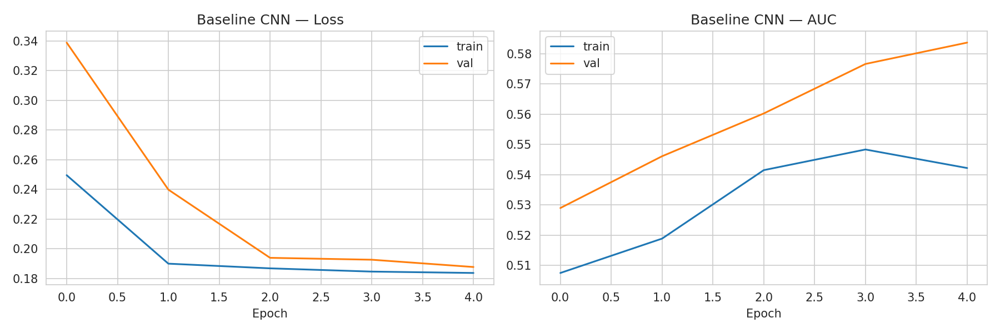 Baseline CNN training curves (cell 11)</td><td align="center" width="50%">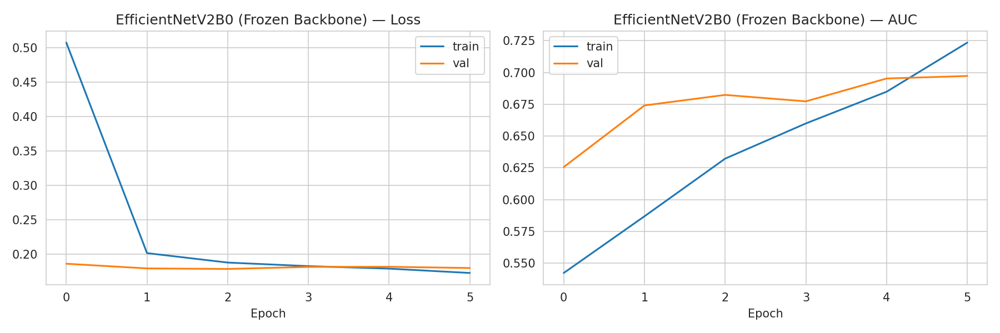 Frozen-backbone transfer-learning curves (cell 14)</td></tr>
<tr><td align="center" width="50%">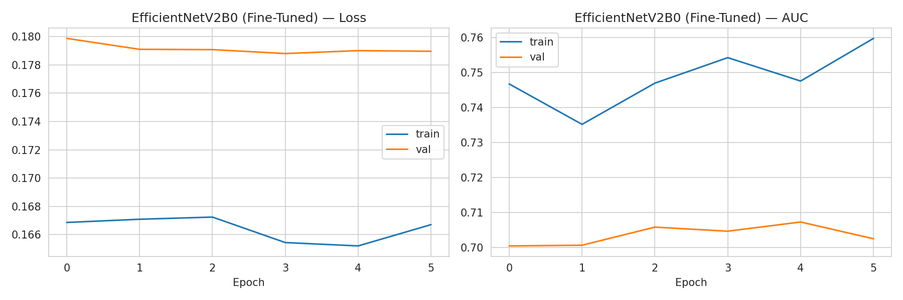 Fine-tuning curves (cell 16)</td><td align="center" width="50%">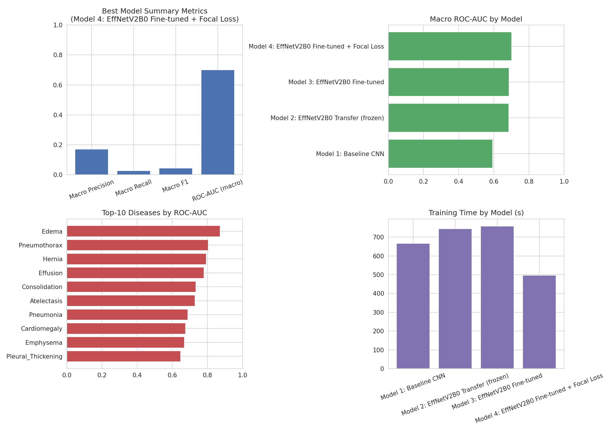 Final results dashboard produced by the notebook (cell 29)</td></tr>
</table>

Observations: (i) the baseline CNN is still improving after 5 epochs but is far below the pre-trained models; (ii) the frozen-backbone model improves steadily and its validation AUC saturates around 0.69-0.70; (iii) fine-tuning adds only about 0.01 validation AUC while the training AUC rises faster than the validation AUC, an early sign of over-fitting on 3,931 training images; (iv) the focal-loss stage changes the loss scale (it is not comparable to BCE) but gives the best validation AUC, 0.7097.

---

## 8. Model comparison

| Model | Subset acc. | Macro prec. | Macro recall | Macro F1 | Micro F1 | Macro ROC-AUC | Train time (s) |
| :--- | ---: | ---: | ---: | ---: | ---: | ---: | ---: |
| Model 1: Baseline CNN (scratch) | 0.5630 | 0.0000 | 0.0000 | 0.0000 | 0.0000 | 0.5934 | 667.5 |
| Model 2: EfficientNetV2B0 transfer (frozen) | 0.5375 | 0.1248 | 0.0211 | 0.0317 | 0.0973 | 0.6852 | 744.4 |
| Model 3: EfficientNetV2B0 fine-tuned | 0.5339 | 0.1205 | 0.0225 | 0.0339 | 0.0964 | 0.6871 | 759.4 |
| Model 4: EfficientNetV2B0 fine-tuned + focal loss | 0.5496 | 0.1721 | 0.0271 | 0.0442 | 0.0848 | 0.7012 | 497.1 |

| Model | Best validation macro AUC | Best epoch | Test macro AUC | Gap (val - test) |
| :--- | ---: | ---: | ---: | ---: |
| Model 1: Baseline CNN (scratch) | 0.5837 | 5 | 0.5934 | -0.0096 |
| Model 2: EfficientNetV2B0 transfer (frozen) | 0.6973 | 6 | 0.6852 | +0.0121 |
| Model 3: EfficientNetV2B0 fine-tuned | 0.7073 | 5 | 0.6871 | +0.0202 |
| Model 4: EfficientNetV2B0 fine-tuned + focal loss | 0.7097 | 4 | 0.7012 | +0.0086 |

 <em>Comparison of the four main models on the test set</em>

**Reading the table.**

* **Transfer learning is the big win:** replacing the scratch CNN by a frozen ImageNet backbone raises the test macro AUC by +0.0918. Fine-tuning adds +0.0019 and the focal loss +0.0141, a total gain of +0.1078 over the baseline.
* The **baseline CNN predicts "no disease" for every label at threshold 0.5**: its precision, recall and F1 are exactly 0. Its subset accuracy (0.5630) equals the proportion of test images without any finding (465 of 826) - a textbook example of why accuracy cannot be trusted on imbalanced multi-label data.
* At the default threshold 0.5 all models are extremely conservative (macro recall at most 0.027), because probabilities for rare findings rarely exceed 0.5. This is the motivation for per-disease thresholds (section 10); macro AUC, which does not depend on a threshold, is the fair ranking metric and is therefore used to select Model 4. (Transparency note: the notebook ranked the four models by their *test* macro AUC; the validation ranking - 0.7097 > 0.7073 > 0.6973 > 0.5837 - is identical, so the selection would not change if it had been made on validation alone.)
* Validation and test AUC agree within about 0.02 for the pre-trained models (validation 0.697-0.710, test 0.685-0.701), so there is no sign that the model selection over-fitted the validation split.
* The micro-averaged ROC-AUC of Model 4 is **0.7974**, higher than the macro value because the common diseases (Infiltration, Effusion, Atelectasis) dominate the pooled decisions and a part of the micro AUC comes from the model learning label prevalence.

---

## 9. Per-disease results

Each row below is for the final model (Model 4) on the 826 test images. The confidence interval uses the Hanley-McNeil approximation of the standard error of the AUC; it is only a guide, and for diseases with fewer than about 20 positives it is very wide.

| Disease | ROC-AUC | 95% CI (approx.) | Test + | Avg. precision | Random AP | AP lift |
| :--- | ---: | ---: | ---: | ---: | ---: | ---: |
| Edema | 0.8726 | 0.770 - 0.975 | 19 | 0.1265 | 0.0230 | 5.5x |
| Pneumothorax | 0.8041 | 0.718 - 0.890 | 37 | 0.2740 | 0.0448 | 6.1x |
| Hernia | 0.7927 | 0.264 - 1.000 | 1 | 0.0058 | 0.0012 | 4.8x |
| Effusion | 0.7796 | 0.723 - 0.836 | 96 | 0.2745 | 0.1162 | 2.4x |
| Consolidation | 0.7344 | 0.637 - 0.832 | 34 | 0.1157 | 0.0412 | 2.8x |
| Atelectasis | 0.7293 | 0.661 - 0.798 | 72 | 0.1736 | 0.0872 | 2.0x |
| Pneumonia | 0.6890 | 0.495 - 0.883 | 9 | 0.0275 | 0.0109 | 2.5x |
| Cardiomegaly | 0.6760 | 0.507 - 0.845 | 12 | 0.2336 | 0.0145 | 16.1x |
| Emphysema | 0.6686 | 0.537 - 0.800 | 20 | 0.0617 | 0.0242 | 2.5x |
| Pleural_Thickening | 0.6476 | 0.524 - 0.771 | 23 | 0.0765 | 0.0278 | 2.7x |
| Fibrosis | 0.6356 | 0.465 - 0.806 | 12 | 0.0291 | 0.0145 | 2.0x |
| Nodule | 0.6288 | 0.540 - 0.717 | 46 | 0.0991 | 0.0557 | 1.8x |
| Mass | 0.6110 | 0.519 - 0.703 | 43 | 0.1093 | 0.0521 | 2.1x |
| Infiltration | 0.5467 | 0.494 - 0.600 | 143 | 0.2515 | 0.1731 | 1.5x |
| **macro mean** | 0.7012 | - | 40.5 | 0.1327 | - | - |

 <em>Per-disease ROC-AUC on the test set; error bars are approximate 95% confidence intervals</em>

 <em>Average precision (PR-AUC) versus the random-guess baseline per disease</em>

<table>
<tr><td align="center" width="50%">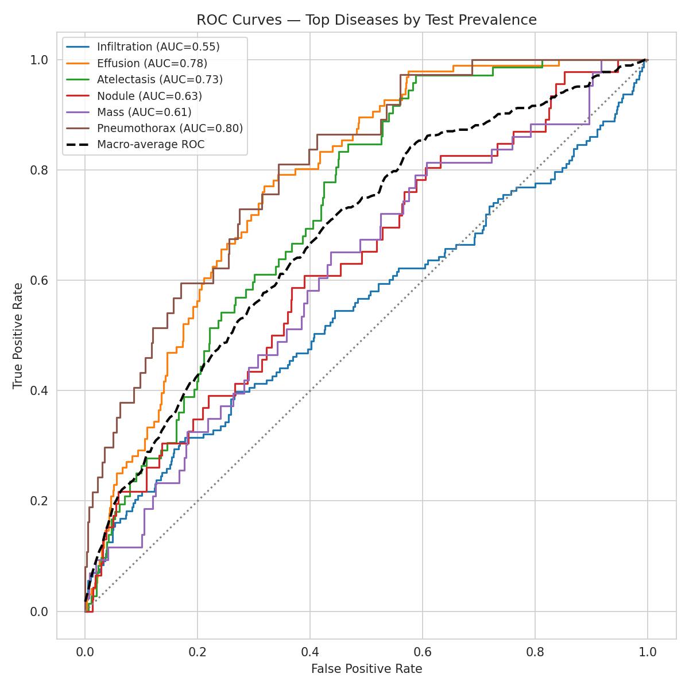 Per-disease ROC curves on the test set (cell 22)</td><td align="center" width="50%">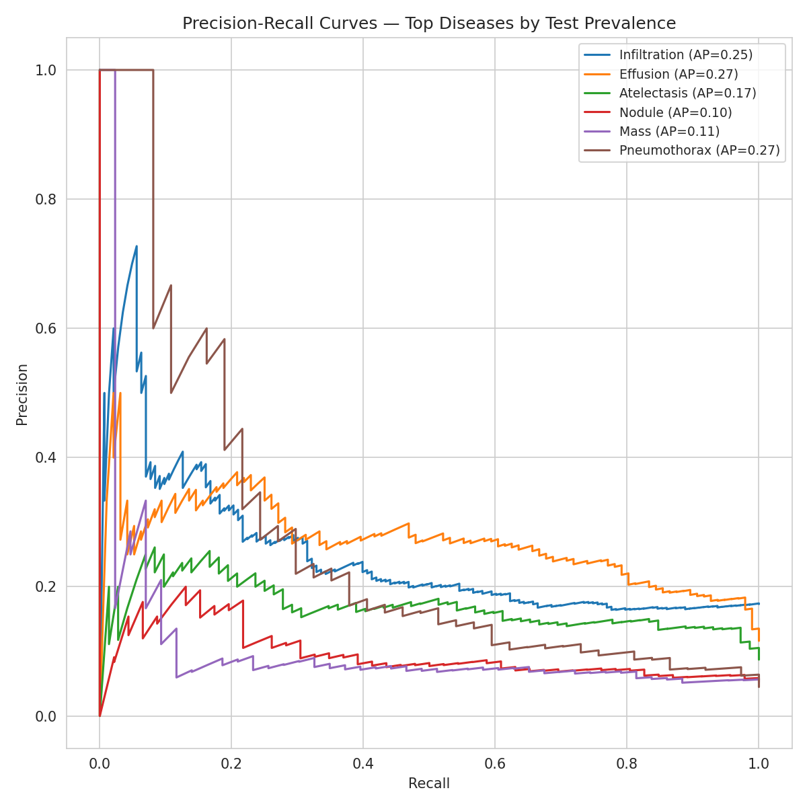 Per-disease precision-recall curves on the test set (cell 23)</td></tr>
</table>

**Findings.**

* The AUC is significantly above 0.5 (lower confidence limit above 0.5) for **Edema, Pneumothorax, Effusion, Consolidation, Atelectasis, Cardiomegaly, Emphysema, Pleural_Thickening, Nodule and Mass**. For **Hernia, Pneumonia, Fibrosis and Infiltration** the interval includes 0.5, so these results cannot be distinguished from chance with the available test data.
* Edema (0.873) is the best-ranked disease. Its interval is nevertheless wide because only 19 test images are positive.
* Infiltration, the most frequent finding, has the lowest AUC (0.547). Infiltration is the most non-specific label of the dataset (a catch-all for hazy opacities) and it overlaps with consolidation, atelectasis and edema, so a model cannot easily learn a consistent visual signature for it. The same label is also among the hardest in published work (CheXNet reaches only 0.7345 on it).
* **Average precision is far above the random-guess value** for several rare findings: the largest lifts are Cardiomegaly (16.1x), Pneumothorax (6.1x), Edema (5.5x) and Hernia (4.8x). Even where AUC is modest, the model concentrates true positives at the top of its ranking.
* Hernia has a single test positive, so its AUC (0.793) is a statement about one image and must not be interpreted.

### Results at the default threshold 0.5

| Disease | Precision @0.5 | Recall @0.5 | F1 @0.5 | Avg. precision | Test + |
| :--- | ---: | ---: | ---: | ---: | ---: |
| Edema | 0.3333 | 0.0526 | 0.0909 | 0.1265 | 19 |
| Pneumothorax | 0.7500 | 0.0811 | 0.1463 | 0.2740 | 37 |
| Hernia | 0.0000 | 0.0000 | 0.0000 | 0.0058 | 1 |
| Effusion | 0.3256 | 0.1458 | 0.2014 | 0.2745 | 96 |
| Consolidation | 0.0000 | 0.0000 | 0.0000 | 0.1157 | 34 |
| Atelectasis | 0.0000 | 0.0000 | 0.0000 | 0.1736 | 72 |
| Pneumonia | 0.0000 | 0.0000 | 0.0000 | 0.0275 | 9 |
| Cardiomegaly | 0.0000 | 0.0000 | 0.0000 | 0.2336 | 12 |
| Emphysema | 0.0000 | 0.0000 | 0.0000 | 0.0617 | 20 |
| Pleural_Thickening | 0.3333 | 0.0435 | 0.0769 | 0.0765 | 23 |
| Fibrosis | 0.0000 | 0.0000 | 0.0000 | 0.0291 | 12 |
| Nodule | 0.0000 | 0.0000 | 0.0000 | 0.0991 | 46 |
| Mass | 0.0000 | 0.0000 | 0.0000 | 0.1093 | 43 |
| Infiltration | 0.6667 | 0.0559 | 0.1032 | 0.2515 | 143 |
| **macro mean** | 0.1721 | 0.0271 | 0.0442 | 0.1327 | - |

At 0.5 only 5 diseases (Effusion, Infiltration, Pneumothorax, Edema and Pleural_Thickening) ever produce a positive prediction; macro F1 is 0.0442. The same ranking quality becomes useful only after thresholds are adapted to each disease.

---

## 10. Threshold optimisation

A fixed threshold of 0.5 is optimal only for balanced, calibrated problems. For each disease a grid of thresholds (0.05 to 0.93 in steps of 0.02) was scanned on the **validation split** and the one maximising F1 was kept (0.5 would have been used for a disease with no validation positive; this did not occur). The thresholds were then frozen and applied to the test split, so no test information was used.

| Disease | Threshold | Precision | Recall | F1 | Accuracy | Specificity | ROC-AUC |
| :--- | ---: | ---: | ---: | ---: | ---: | ---: | ---: |
| Edema | 0.21 | 0.1000 | 0.1579 | 0.1224 | 0.9479 | 0.9665 | 0.8726 |
| Pneumothorax | 0.23 | 0.2353 | 0.3243 | 0.2727 | 0.9225 | 0.9506 | 0.8041 |
| Hernia | 0.05 | 0.0000 | 0.0000 | 0.0000 | 0.9964 | 0.9976 | 0.7927 |
| Effusion | 0.31 | 0.2652 | 0.3646 | 0.3070 | 0.8087 | 0.8671 | 0.7796 |
| Consolidation | 0.05 | 0.0904 | 0.4706 | 0.1517 | 0.7833 | 0.7967 | 0.7344 |
| Atelectasis | 0.11 | 0.1583 | 0.3056 | 0.2085 | 0.7978 | 0.8448 | 0.7293 |
| Pneumonia | 0.05 | 0.0508 | 0.3333 | 0.0882 | 0.9249 | 0.9315 | 0.6890 |
| Cardiomegaly | 0.09 | 0.2727 | 0.2500 | 0.2609 | 0.9794 | 0.9902 | 0.6760 |
| Emphysema | 0.11 | 0.0909 | 0.0500 | 0.0645 | 0.9649 | 0.9876 | 0.6686 |
| Pleural_Thickening | 0.07 | 0.0459 | 0.2174 | 0.0758 | 0.8523 | 0.8705 | 0.6476 |
| Fibrosis | 0.05 | 0.0323 | 0.0833 | 0.0465 | 0.9504 | 0.9631 | 0.6356 |
| Nodule | 0.09 | 0.1121 | 0.2609 | 0.1569 | 0.8438 | 0.8782 | 0.6288 |
| Mass | 0.11 | 0.1000 | 0.1163 | 0.1075 | 0.8995 | 0.9425 | 0.6110 |
| Infiltration | 0.13 | 0.1721 | 0.6643 | 0.2734 | 0.3886 | 0.3309 | 0.5467 |
| **macro mean** | - | 0.1233 | 0.2570 | 0.1526 | 0.8615 | 0.8798 | 0.7012 |

 <em>Selected per-disease thresholds and their effect on test F1</em>

| Metric (test) | At 0.5 | At tuned thresholds | Change |
|:---|---:|---:|---:|
| Macro F1 | 0.0442 | 0.1526 | x3.45 |
| Micro F1 | 0.0848 | 0.2101 | x2.48 |
| Macro recall | 0.0271 | 0.2570 | x9.5 |
| Macro precision | 0.1721 | 0.1233 | x0.72 |

Thresholds between 0.05 and 0.31 are typical, i.e. much lower than 0.5, which confirms that the sigmoid outputs are shifted towards zero by the imbalance. The price is paid in precision: Infiltration reaches recall 0.664 but its accuracy drops to 0.389 and 457 false positives appear, an operating point that would be a nuisance in practice. The thresholds are a statistical tool for this study, not clinical operating points.

 <em>Per-disease precision, recall and F1 on the test set after threshold optimisation</em>

---

## 11. Confusion matrices and error analysis

The counts below are derived exactly from the recorded precision, recall and specificity at the tuned thresholds. They reproduce the totals logged by the notebook (1,248 false positives and 354 false negatives over 826 x 14 decisions).

| Disease | TP | FP | FN | TN | Test + |
| :--- | ---: | ---: | ---: | ---: | ---: |
| Atelectasis | 22 | 117 | 50 | 637 | 72 |
| Cardiomegaly | 3 | 8 | 9 | 806 | 12 |
| Effusion | 35 | 97 | 61 | 633 | 96 |
| Infiltration | 95 | 457 | 48 | 226 | 143 |
| Mass | 5 | 45 | 38 | 738 | 43 |
| Nodule | 12 | 95 | 34 | 685 | 46 |
| Pneumonia | 3 | 56 | 6 | 761 | 9 |
| Pneumothorax | 12 | 39 | 25 | 750 | 37 |
| Consolidation | 16 | 161 | 18 | 631 | 34 |
| Edema | 3 | 27 | 16 | 780 | 19 |
| Emphysema | 1 | 10 | 19 | 796 | 20 |
| Fibrosis | 1 | 30 | 11 | 784 | 12 |
| Pleural_Thickening | 5 | 104 | 18 | 699 | 23 |
| Hernia | 0 | 2 | 1 | 823 | 1 |
| **total** | 213 | 1248 | 354 | 9749 | 567 |

 <em>Per-disease confusion matrices (counts) at the optimised thresholds</em>

 <em>False positives and false negatives per disease</em>

<table>
<tr><td align="center" width="50%">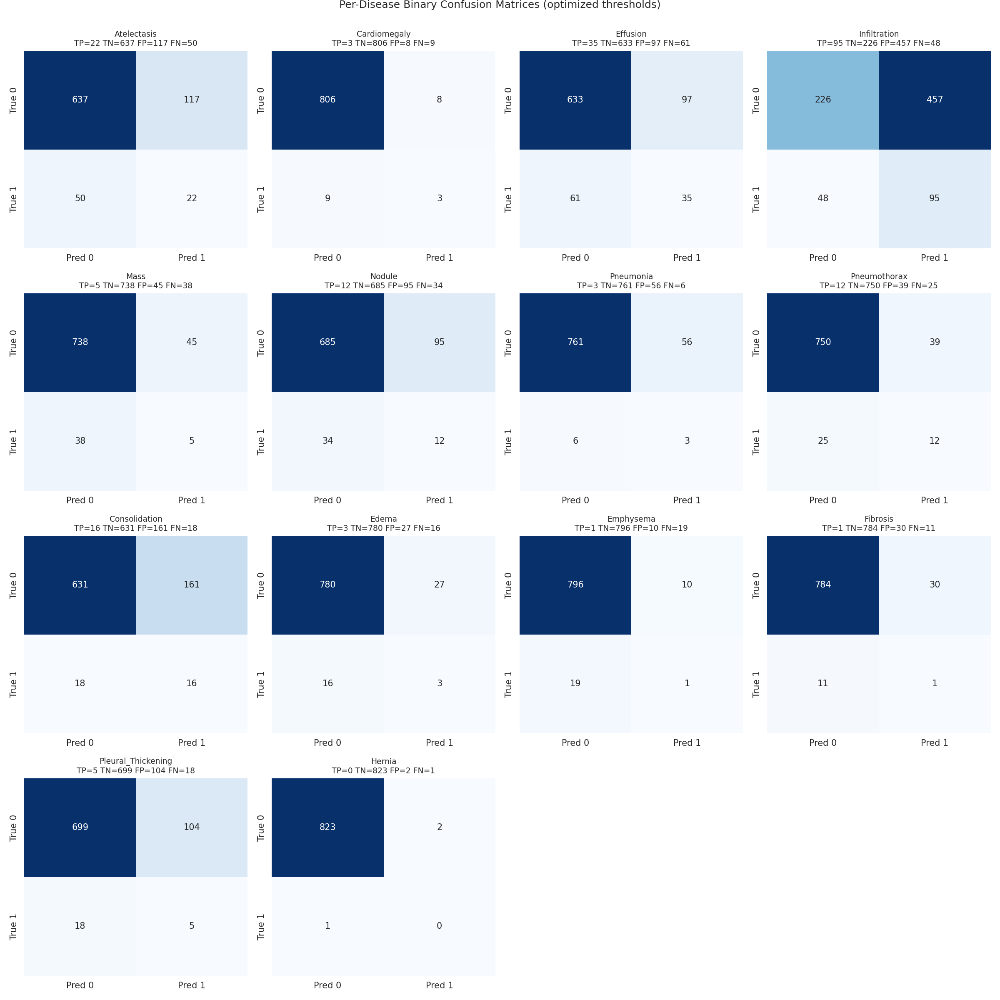 Per-disease confusion matrices from the notebook (cell 21)</td><td align="center" width="50%">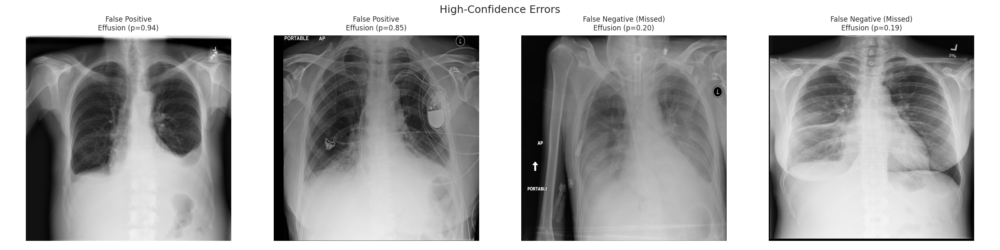 False positives, false negatives and high-confidence mistakes (cell 25)</td></tr>
</table>

* False positives are concentrated in **Infiltration (457), Consolidation (161) and Atelectasis (117)**, the visually overlapping opacity classes, as expected from the label definitions. Because those diseases are also frequent, a low threshold produces many alarms.
* The **miss rate** (1 - recall) is highest for Hernia (100%), Emphysema (95%), Fibrosis (92%), Mass (88%) and Edema (84%), mostly classes with few training positives (Hernia 10, Fibrosis 57, Emphysema 88, Edema 83).
* The notebook additionally logged 331 **high-confidence mistakes** (confident wrong predictions) and rendered examples of them in the figure above.

---

## 12. Explainability with Grad-CAM

Grad-CAM was computed from the last convolutional activation of the EfficientNetV2B0 backbone (`top_activation`, 7 x 7 resolution). The explanation is built from the **same model** that makes the prediction (the best model selected in section 8) by splitting it into the backbone and the classification head and back-propagating the score of the target class to the final feature map. For each sample test image the heat-map of the top predicted disease is overlaid on the radiograph.

 <em>Grad-CAM heat-maps on test images, target = top predicted class (cell 24)</em>

Important cautions: Grad-CAM is a coarse (7 x 7, up-sampled) *post-hoc* explanation. A heat-map over the lung fields shows where the network looked, not that it reasoned like a radiologist; heat-maps over text markers, the shoulder or the image border would indicate shortcut learning. Three examples were inspected in the notebook; a systematic localisation study against bounding boxes was not performed and is listed under future work.

---

## 13. Calibration and test-time augmentation

**Calibration.** Reliability diagrams and probability histograms were produced for the model outputs. A predicted probability is the network's learned confidence under the training distribution, not a clinically validated risk; with thresholds as low as 0.05 the raw probabilities cannot be read as "5% chance".

<table>
<tr><td align="center" width="50%">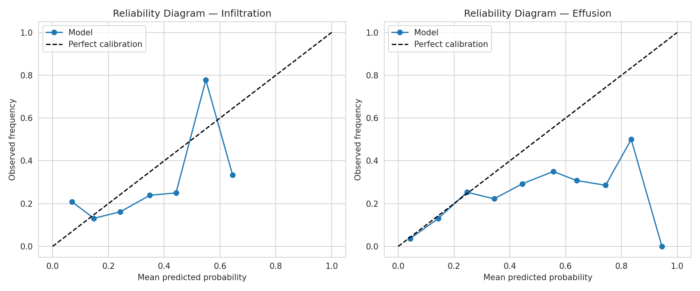 Reliability (calibration) diagrams for two diseases (cell 27)</td><td align="center" width="50%">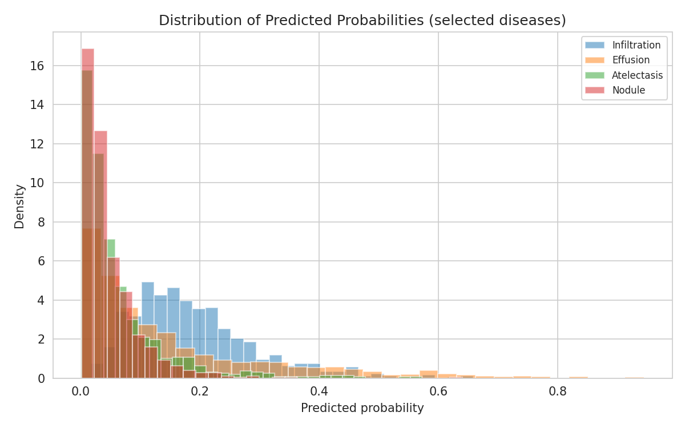 Predicted-probability distributions for positives and negatives (cell 27)</td></tr>
</table>

**Test-time augmentation (TTA).** Predictions were averaged over mildly augmented copies of 200 test images (13 of 14 diseases had both classes in that subset). The macro AUC was 0.7139 without and 0.7136 with TTA; macro F1 0.0676 versus 0.0683. TTA therefore **did not help**: the perturbations are small relative to the model's confidence, and a 200-image subset cannot resolve differences of this size anyway.

 <em>Error totals and the test-time-augmentation comparison</em>

---

## 14. Innovation and ablation (CO5)

**Hypothesis.** The two weaknesses visible so far are (A) the loss: a plain or focal loss still lets the many easy negatives dominate, and (B) limited capacity to adapt, with (C) a single backbone providing a single "view" of the image. The proposed system addresses them with three additions, evaluated one by one:

* **A - Asymmetric loss (ASL)** with gamma- = 4, gamma+ = 0 and probability shifting (clip 0.05) so that easy negatives contribute almost nothing while every positive keeps full weight.
* **B - Deeper fine-tuning:** 60% of the backbone unfrozen instead of 30%.
* **C - Two-backbone ensemble:** the average of the predicted probabilities of EfficientNetV2B0 and an ImageNet-initialised DenseNet121 (the architecture of CheXNet), whose errors are partly independent.

All runs use the same data, optimiser, seeds and epochs; thresholds are tuned on validation and metrics are computed on the test set over the 12 diseases with at least 10 test positives (Pneumonia and Hernia are excluded because their AUC is not estimable).

| Experiment | A: ASL | B: deep FT | C: ensemble | Macro AUC (12 cls) | Macro F1 | Micro F1 | Trainable params | Total params | Min |
| :--- | :---: | :---: | :---: | ---: | ---: | ---: | ---: | ---: | ---: |
| EffNetV2B0 + BCE, 30% unfrozen (reference) | - | - | - | 0.6955 | 0.1361 | 0.2272 | 3,088,894 | 5,942,366 | 16.6 |
| +A  asymmetric loss (ASL) | yes | - | - | 0.6972 | 0.1309 | 0.1804 | 3,088,894 | 5,942,366 | 20.5 |
| +A+B  deeper fine-tuning (60% unfrozen) | yes | yes | - | 0.6958 | 0.1596 | 0.2125 | 4,970,030 | 5,942,366 | 19.4 |
| DenseNet121 + ASL (60% unfrozen) | yes | yes | - | 0.7180 | 0.1810 | 0.2041 | 5,169,166 | 7,055,950 | 27.5 |
| +A+B+C  proposed: EffNetV2B0 + DenseNet121 ensemble | yes | yes | yes | 0.7312 | 0.1843 | 0.2201 | 10,139,196 | 12,998,316 | 46.9 |

 <em>Innovation ablation: effect of ASL, deeper fine-tuning and the two-backbone ensemble</em>

 <em>Validation AUC trajectories of the ablation runs</em>

**Results.** Asymmetric loss alone changes the 12-class AUC by +0.0017 (and macro F1 by -0.0052); deeper fine-tuning on top of it adds -0.0014 AUC but lifts macro F1 to 0.1596. DenseNet121 with the same recipe reaches 0.7180, better than the EfficientNet variants. The **ensemble reaches 0.7312**, i.e. +0.0357 over the reference and +0.0132 over its best member, with macro F1 0.1843 (reference 0.1361). Therefore the improvement does not come from the loss or the depth of fine-tuning (both are within +-0.002 AUC) but from combining two architectures.

**Honest assessment.** The gain of the ensemble over a single backbone is real in the measurements but it comes from one training seed and one test split; with test positives of 12-143 per disease the standard error of a macro AUC difference of 0.01-0.03 is of the same order as the effect. The ensemble doubles training cost (46.9 vs 16.6-27.5 minutes) and parameters (13.0 M vs 5.9 M). The saved deployable model of the repository remains Model 4 (single network); the ensemble is an experiment whose result is documented here and in [`results/ablation.csv`](results/ablation.csv).

---

## 15. Comparison with published methods (CO4)

All published numbers are the per-class test AUROC values reported in the original papers on the **full 112,120-image ChestX-ray14 dataset** (see references 1-3). They are therefore *not* strictly comparable with this project: the training set here is about 20 times smaller (3,931 images versus roughly 78,000, i.e. 70% of 112,120), the split differs, and images are at 224 x 224.

| Method | Training data | Classes scored | Mean AUROC (14) | Mean AUROC (12) |
| :--- | ---: | ---: | ---: | ---: |
| Wang et al. 2017 (ChestX-ray8, ResNet-50) | full 112,120 images | 14 / 14 | 0.7381 | 0.7445 |
| Yao et al. 2017 (DenseNet + LSTM) | full 112,120 images | 14 / 14 | 0.8027 | 0.8009 |
| Rajpurkar et al. 2017 (CheXNet, DenseNet-121) | full 112,120 images | 14 / 14 | 0.8414 | 0.8412 |
| This project - Model 4 (single model, saved) | 5,606-image sample | 14 / 14 | 0.7012 | 0.6945 |
| This project - proposed ensemble (CO5 experiment) | 5,606-image sample | 12 (>=10 test +) | - | 0.7312 |

| Disease | Wang et al. 2017 | Yao et al. 2017 | Rajpurkar et al. 2017 | This project (Model 4) | Delta vs CheXNet |
| :--- | ---: | ---: | ---: | ---: | ---: |
| Atelectasis | 0.7160 | 0.7720 | 0.8094 | 0.7293 | -0.0801 |
| Cardiomegaly | 0.8070 | 0.9040 | 0.9248 | 0.6760 | -0.2488 |
| Effusion | 0.7840 | 0.8590 | 0.8638 | 0.7796 | -0.0842 |
| Infiltration | 0.6090 | 0.6950 | 0.7345 | 0.5467 | -0.1878 |
| Mass | 0.7060 | 0.7920 | 0.8676 | 0.6110 | -0.2566 |
| Nodule | 0.6710 | 0.7170 | 0.7802 | 0.6288 | -0.1514 |
| Pneumonia | 0.6330 | 0.7130 | 0.7680 | 0.6890 | -0.0790 |
| Pneumothorax | 0.8060 | 0.8410 | 0.8887 | 0.8041 | -0.0846 |
| Consolidation | 0.7080 | 0.7880 | 0.7901 | 0.7344 | -0.0557 |
| Edema | 0.8350 | 0.8820 | 0.8878 | 0.8726 | -0.0152 |
| Emphysema | 0.8150 | 0.8290 | 0.9371 | 0.6686 | -0.2685 |
| Fibrosis | 0.7690 | 0.7670 | 0.8047 | 0.6356 | -0.1691 |
| Pleural_Thickening | 0.7080 | 0.7650 | 0.8062 | 0.6476 | -0.1586 |
| Hernia | 0.7670 | 0.9140 | 0.9164 | 0.7927 | -0.1237 |
| **mean, all 14** | 0.7381 | 0.8027 | 0.8414 | 0.7012 | -0.1402 |
| **mean, 12 classes (>=10 test +)** | 0.7445 | 0.8009 | 0.8412 | 0.6945 | -0.1467 |

 <em>Per-class AUROC of three published methods and of this project</em>

 <em>Mean AUROC of published methods and this project</em>

 <em>Per-disease AUROC difference between this project and CheXNet</em>

**Discussion.**

* This project (mean AUROC 0.7012) is **0.1402 below CheXNet** (0.8414), 0.1016 below Yao et al. (0.8027) and 0.0370 below the Wang et al. baseline (0.7381). On the 12 well-populated classes the gap to CheXNet is 0.1467 (0.6945 versus 0.8412).
* Within 0.05 AUROC of CheXNet: Edema; the next closest are Consolidation (-0.056) and Pneumonia (-0.079). The project exceeds the early Wang et al. baseline on Atelectasis, Pneumonia, Consolidation, Edema and Hernia (for Edema and Hernia the test positives number only 19 and 1, so these are weak statements).
* The largest gaps are Emphysema (-0.268, 88 training positives), Mass (-0.257, 195 training positives), Cardiomegaly (-0.249, 110 training positives), Infiltration (-0.188, 674 training positives) and Fibrosis (-0.169, 57 training positives). Plausible reasons - none of which was isolated by an experiment here - are the 20x smaller training set, the small number of positives per class, the short schedule (at most 16 epochs), the lower input resolution (224 x 224) and the architecture (EfficientNetV2B0 versus DenseNet-121).
* The innovation ensemble closes only part of the gap on the 12-class metric (0.731 versus 0.841 for CheXNet), which suggests that data volume, and not only architecture, limits performance.

---

## 16. Discussion

**What worked.** Patient-level splitting removed a source of optimistic bias; transfer learning gave a large and robust improvement; a validation-tuned threshold per disease tripled macro F1 without touching the test set; the ranking quality (AP lift) is well above chance for several rare diseases; the ablation shows a measurable benefit of combining two different backbones.

**What did not work.** Fine-tuning gave only +0.002 test AUC; focal loss and ASL alone changed AUC by about +0.014 and +0.002 respectively; TTA gave nothing; Infiltration, Mass and Nodule stay near AUC 0.55-0.63.

**Why the absolute level is modest (hypotheses).** Small data (about 5.6k images against 112k), heavy imbalance, noisy report-derived labels, a low 224 x 224 resolution that erases small nodules, and a short schedule on a free GPU. The experiments here do not isolate the contribution of each cause.

**What the evidence does not show.** Nothing here proves clinical usefulness, generalisation to other hospitals or scanners, or fairness across sex and age groups. No external validation set was used.

---

## 17. Limitations and threats to validity

1. Only a 5,606-image sample of the dataset is used; 7 of the 14 diseases have fewer than 25 test positives.
2. A single random seed and a single patient-level split: no cross-validation, no repeated runs, so no variance estimate across training runs. The confidence intervals above reflect only test-set sampling noise.
3. Labels are weak (NLP-extracted from reports) and some classes are ambiguous.
4. Thresholds were tuned for F1 on a validation split that is itself small (for example 2 Hernia positives); they are therefore noisy for rare classes.
5. The ablation experiment and the main models were trained in separate runs; the ablation metric uses 12 diseases, the main table 14, so the two numbers must not be compared directly.
6. Published figures come from different splits and full-size training data.
7. Sex and age subgroups were not analysed. The data contain more men (55.9%) than women.
8. The choice of Model 4 among the four candidates was made by test macro AUC in the notebook (the validation ranking agrees), a mild form of test-set reuse; thresholds and all other tuning used validation only.
8. Intended use is education and research only.

---

## 18. Future work

* Train on the full 112,120-image dataset (or the larger NIH/CheXpert/MIMIC-CXR collections) at 320-512 px.
* Use 5-fold patient-level cross-validation and several seeds to report mean +- standard deviation.
* Exploit label dependencies (graph or LSTM label models) and the "view position" metadata (AP versus PA).
* Replace Grad-CAM with a localisation benchmark against the NIH bounding boxes and add sanity checks (model-randomisation tests).
* Calibrate with temperature scaling and report expected calibration error.
* Evaluate fairness by sex and age and test on an external dataset.

---

## 19. Reproducibility

| Component | Value (as printed by the notebook) |
| :--- | :--- |
| Python | 3.13.15 |
| TensorFlow / Keras | 2.21.0 |
| GPU | Tesla T4, 15,360 MiB, mixed precision enabled |
| Dataset | kagglehub dataset nih-chest-xrays/sample, version 4 |
| Notebook | [Google Colab notebook](https://colab.research.google.com/drive/1jgplvn6oFYI93MF0KZumF6Mfa_XRWkIv) |

* Seeds: `SEED = 42` for Python, NumPy and TensorFlow; the patient shuffle uses `RandomState(42)`. GPU kernels remain partly non-deterministic, so re-running can differ in the third decimal.
* Run the notebook top to bottom on a GPU runtime (about 2.1 hours of GPU time: 44 minutes for the four main models and 84 minutes for the ablation runs) or use the modular code in [`code/`](../../code/README.md); the step-by-step guide is [`code/RUN_GUIDE.md`](../../code/RUN_GUIDE.md).
* Kaggle credentials are required once per session to download the dataset through `kagglehub`.
* Every number in this README comes from the recorded run; the machine-readable originals are in [`results/`](results/README.md) and in [`resources/results/`](../../resources/results/README.md).

---

## 20. File index

| File | Type |
| :--- | :--- |
| [`CO_MAPPING.md`](CO_MAPPING.md) | md |
| [`README.md`](README.md) | md |
| [`figures/README.md`](figures/README.md) | md |
| [`figures/augmentation_examples.png`](figures/augmentation_examples.png) | png |
| [`figures/baseline_history.png`](figures/baseline_history.png) | png |
| [`figures/confusion_matrices_grid.png`](figures/confusion_matrices_grid.png) | png |
| [`figures/error_analysis_examples.png`](figures/error_analysis_examples.png) | png |
| [`figures/fig_ablation.png`](figures/fig_ablation.png) | png |
| [`figures/fig_ablation_val_auc.png`](figures/fig_ablation_val_auc.png) | png |
| [`figures/fig_ap_vs_prevalence.png`](figures/fig_ap_vs_prevalence.png) | png |
| [`figures/fig_class_distribution.png`](figures/fig_class_distribution.png) | png |
| [`figures/fig_confusion_grid.png`](figures/fig_confusion_grid.png) | png |
| [`figures/fig_error_breakdown.png`](figures/fig_error_breakdown.png) | png |
| [`figures/fig_errors_tta.png`](figures/fig_errors_tta.png) | png |
| [`figures/fig_gap_to_chexnet.png`](figures/fig_gap_to_chexnet.png) | png |
| [`figures/fig_imbalance_ratio.png`](figures/fig_imbalance_ratio.png) | png |
| [`figures/fig_model_comparison.png`](figures/fig_model_comparison.png) | png |
| [`figures/fig_per_disease_auc_ci.png`](figures/fig_per_disease_auc_ci.png) | png |
| [`figures/fig_per_disease_prf.png`](figures/fig_per_disease_prf.png) | png |
| [`figures/fig_pipeline.png`](figures/fig_pipeline.png) | png |
| [`figures/fig_sota_means.png`](figures/fig_sota_means.png) | png |
| [`figures/fig_sota_per_class.png`](figures/fig_sota_per_class.png) | png |
| [`figures/fig_split_overview.png`](figures/fig_split_overview.png) | png |
| [`figures/fig_thresholds_f1.png`](figures/fig_thresholds_f1.png) | png |
| [`figures/fig_training_curves.png`](figures/fig_training_curves.png) | png |
| [`figures/fig_val_auc_overlay.png`](figures/fig_val_auc_overlay.png) | png |
| [`figures/final_dashboard.png`](figures/final_dashboard.png) | png |
| [`figures/finetune_history.png`](figures/finetune_history.png) | png |
| [`figures/gradcam_visualizations.png`](figures/gradcam_visualizations.png) | png |
| [`figures/label_distribution.png`](figures/label_distribution.png) | png |
| [`figures/no_finding_pie.png`](figures/no_finding_pie.png) | png |
| [`figures/pr_curves.png`](figures/pr_curves.png) | png |
| [`figures/probability_distributions.png`](figures/probability_distributions.png) | png |
| [`figures/reliability_diagrams.png`](figures/reliability_diagrams.png) | png |
| [`figures/roc_curves.png`](figures/roc_curves.png) | png |
| [`figures/sample_grid.png`](figures/sample_grid.png) | png |
| [`figures/transfer_learning_history.png`](figures/transfer_learning_history.png) | png |
| [`models/README.md`](models/README.md) | md |
| [`models/disease_labels.json`](models/disease_labels.json) | json |
| [`models/model_description.txt`](models/model_description.txt) | txt |
| [`models/optimized_thresholds.json`](models/optimized_thresholds.json) | json |
| [`requirements.txt`](requirements.txt) | txt |
| [`results/README.md`](results/README.md) | md |
| [`results/ablation.csv`](results/ablation.csv) | csv |
| [`results/class_distribution.csv`](results/class_distribution.csv) | csv |
| [`results/comparison.csv`](results/comparison.csv) | csv |
| [`results/error_analysis.csv`](results/error_analysis.csv) | csv |
| [`results/final_model_comparison.csv`](results/final_model_comparison.csv) | csv |
| [`results/final_per_disease_metrics.csv`](results/final_per_disease_metrics.csv) | csv |
| [`results/history_baseline.csv`](results/history_baseline.csv) | csv |
| [`results/history_fine_tuning.csv`](results/history_fine_tuning.csv) | csv |
| [`results/history_imbalance_aware.csv`](results/history_imbalance_aware.csv) | csv |
| [`results/history_transfer_learning.csv`](results/history_transfer_learning.csv) | csv |
| [`results/model_comparison.csv`](results/model_comparison.csv) | csv |
| [`results/optimized_thresholds.csv`](results/optimized_thresholds.csv) | csv |
| [`results/per_disease_auc_ci.csv`](results/per_disease_auc_ci.csv) | csv |
| [`results/per_disease_confusion_counts.csv`](results/per_disease_confusion_counts.csv) | csv |
| [`results/per_disease_metrics_threshold_0.5.csv`](results/per_disease_metrics_threshold_0.5.csv) | csv |
| [`results/project_summary.csv`](results/project_summary.csv) | csv |
| [`results/results.csv`](results/results.csv) | csv |
| [`results/sota_comparison.csv`](results/sota_comparison.csv) | csv |
| [`results/sota_per_class_auroc.csv`](results/sota_per_class_auroc.csv) | csv |
| [`results/split_distribution.csv`](results/split_distribution.csv) | csv |

---

## 21. Glossary

| Term | Meaning in this project |
| :--- | :--- |
| Multi-label | one image can carry zero, one or several of the 14 findings; each finding is an independent yes/no output (sigmoid), not one softmax class |
| ROC-AUC | probability that a random positive image receives a higher score than a random negative one; 0.5 = chance, 1.0 = perfect; threshold independent |
| Macro vs micro | macro averages the 14 per-disease values equally (rare diseases count as much as common ones); micro pools all image-label decisions (dominated by common diseases) |
| Precision / recall | precision = TP/(TP+FP), recall (sensitivity) = TP/(TP+FN); specificity = TN/(TN+FP); F1 = harmonic mean of precision and recall |
| Average precision (PR-AUC) | area under the precision-recall curve; its random-guess value equals the disease prevalence, so the lift over prevalence is informative for rare findings |
| Subset accuracy | an image counts as correct only if all 14 labels are right; 'predict nothing' already scores 0.563 here, so it is reported but not used for ranking |
| Patient-level split | all images of one patient go to the same split, which prevents the model from memorising patients |
| Transfer learning / fine-tuning | start from ImageNet weights; first train only the new head (frozen backbone), then unfreeze the top backbone layers at a low learning rate |
| Focal loss / ASL | losses that down-weight easy negatives so the many negative labels do not drown the few positives |
| Grad-CAM | gradient-weighted class activation map highlighting image regions that increased the score of a chosen class |
| TTA | test-time augmentation: average predictions over slightly perturbed copies of an image |
| Calibration | whether a predicted probability of 0.3 really corresponds to roughly 30% positives |

---

## 22. References

1. Wang X., Peng Y., Lu L., Lu Z., Bagheri M., Summers R. M. *ChestX-ray8: Hospital-scale chest X-ray database and benchmarks on weakly-supervised classification and localization of common thorax diseases.* CVPR 2017.
2. Rajpurkar P. et al. *CheXNet: Radiologist-level pneumonia detection on chest X-rays with deep learning.* arXiv:1711.05225, 2017.
3. Yao L., Poblenz E., Dagunts D., Covington B., Bernard D., Lyman K. *Learning to diagnose from scratch by exploiting dependencies among labels.* arXiv:1710.10501, 2017.
4. Tan M., Le Q. V. *EfficientNetV2: Smaller models and faster training.* ICML 2021 (arXiv:2104.00298).
5. Huang G., Liu Z., van der Maaten L., Weinberger K. Q. *Densely connected convolutional networks.* CVPR 2017.
6. Lin T.-Y., Goyal P., Girshick R., He K., Dollar P. *Focal loss for dense object detection.* ICCV 2017.
7. Ridnik T. et al. *Asymmetric loss for multi-label classification.* ICCV 2021.
8. Selvaraju R. R. et al. *Grad-CAM: Visual explanations from deep networks via gradient-based localization.* ICCV 2017.
9. Guo C., Pleiss G., Sun Y., Weinberger K. Q. *On calibration of modern neural networks.* ICML 2017.
10. Hanley J. A., McNeil B. J. *The meaning and use of the area under a receiver operating characteristic (ROC) curve.* Radiology 143(1), 1982.
11. NIH Clinical Center. *ChestX-ray14 / NIH Chest X-rays* (Kaggle datasets `nih-chest-xrays/data` and `nih-chest-xrays/sample`).
12. Abadi M. et al. *TensorFlow: Large-scale machine learning on heterogeneous systems*; Chollet F. et al. *Keras*.
