# Figure gallery

## Figures produced by the notebook run

| File | Description |
| :--- | :--- |
| `label_distribution.png` | Disease label frequency across the 5,606-image sample (notebook cell 5) |
| `no_finding_pie.png` | Share of images with no finding versus at least one finding (cell 5) |
| `sample_grid.png` | Random sample of chest X-rays with their original multi-label annotations (cell 5) |
| `augmentation_examples.png` | Augmented training examples: small rotation, shift, zoom, brightness and contrast (cell 9) |
| `baseline_history.png` | Baseline CNN training curves (cell 11) |
| `transfer_learning_history.png` | Frozen-backbone transfer-learning curves (cell 14) |
| `finetune_history.png` | Fine-tuning curves (cell 16) |
| `confusion_matrices_grid.png` | Per-disease confusion matrices from the notebook (cell 21) |
| `roc_curves.png` | Per-disease ROC curves on the test set (cell 22) |
| `pr_curves.png` | Per-disease precision-recall curves on the test set (cell 23) |
| `gradcam_visualizations.png` | Grad-CAM heat-maps on test images, target = top predicted class (cell 24) |
| `error_analysis_examples.png` | False positives, false negatives and high-confidence mistakes (cell 25) |
| `probability_distributions.png` | Predicted-probability distributions for positives and negatives (cell 27) |
| `reliability_diagrams.png` | Reliability (calibration) diagrams for two diseases (cell 27) |
| `final_dashboard.png` | Final results dashboard produced by the notebook (cell 29) |

## Figures generated from the recorded results in the final update

| File | Description |
| :--- | :--- |
| `fig_pipeline.png` | End-to-end pipeline: data -> split -> models -> thresholds -> evaluation -> explainability |
| `fig_split_overview.png` | Split sizes (patient-level) and the share of images without findings |
| `fig_class_distribution.png` | Positive counts per disease in train / validation / test (log scale) |
| `fig_imbalance_ratio.png` | Negative-to-positive ratio per disease in the training split (log scale) |
| `fig_training_curves.png` | Train/validation AUC (top) and loss (bottom) for the four main models |
| `fig_val_auc_overlay.png` | Validation macro-AUC trajectory across the four training stages |
| `fig_model_comparison.png` | Comparison of the four main models on the test set |
| `fig_per_disease_auc_ci.png` | Per-disease ROC-AUC on the test set; error bars are approximate 95% confidence intervals |
| `fig_ap_vs_prevalence.png` | Average precision (PR-AUC) versus the random-guess baseline per disease |
| `fig_per_disease_prf.png` | Per-disease precision, recall and F1 on the test set after threshold optimisation |
| `fig_thresholds_f1.png` | Selected per-disease thresholds and their effect on test F1 |
| `fig_confusion_grid.png` | Per-disease confusion matrices (counts) at the optimised thresholds |
| `fig_error_breakdown.png` | False positives and false negatives per disease |
| `fig_ablation.png` | Innovation ablation: effect of ASL, deeper fine-tuning and the two-backbone ensemble |
| `fig_ablation_val_auc.png` | Validation AUC trajectories of the ablation runs |
| `fig_sota_per_class.png` | Per-class AUROC of three published methods and of this project |
| `fig_sota_means.png` | Mean AUROC of published methods and this project |
| `fig_gap_to_chexnet.png` | Per-disease AUROC difference between this project and CheXNet |
| `fig_errors_tta.png` | Error totals and the test-time-augmentation comparison |

### fig_pipeline.png

 split -> models -> thresholds -> evaluation -> explainability"> <em>End-to-end pipeline: data -> split -> models -> thresholds -> evaluation -> explainability</em>

### fig_split_overview.png

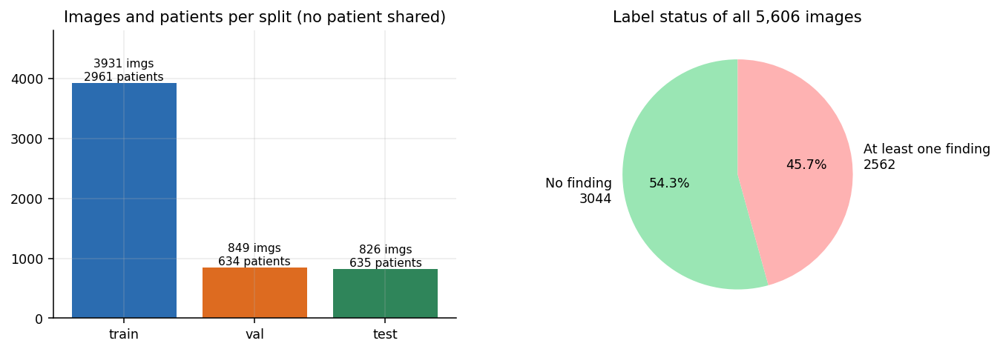 <em>Split sizes (patient-level) and the share of images without findings</em>

### fig_class_distribution.png

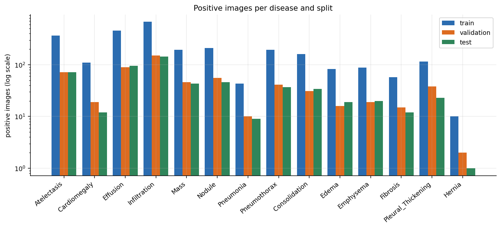 <em>Positive counts per disease in train / validation / test (log scale)</em>

### fig_imbalance_ratio.png

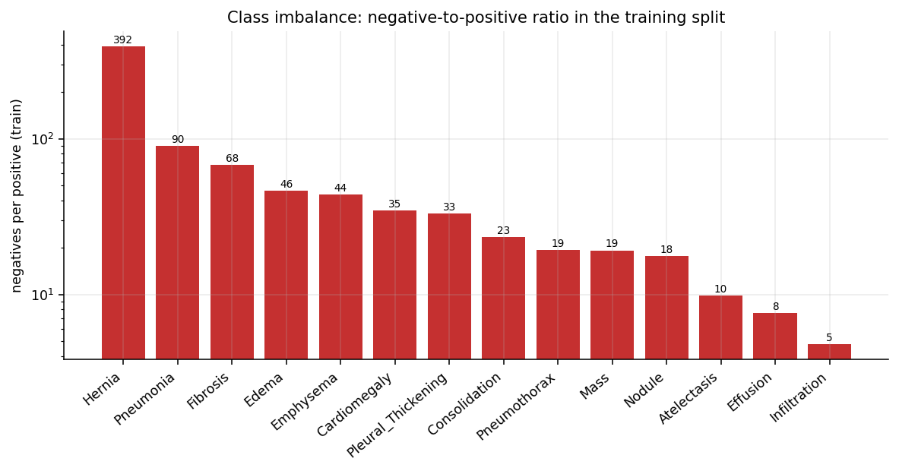 <em>Negative-to-positive ratio per disease in the training split (log scale)</em>

### fig_training_curves.png

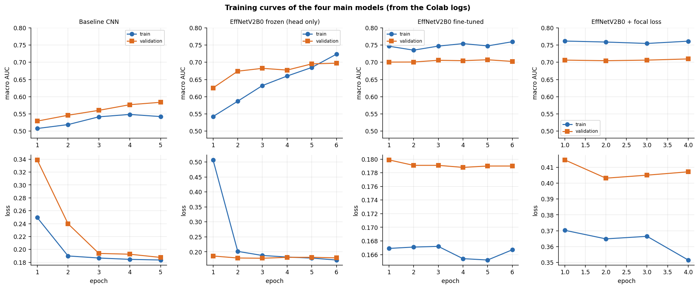 <em>Train/validation AUC (top) and loss (bottom) for the four main models</em>

### fig_val_auc_overlay.png

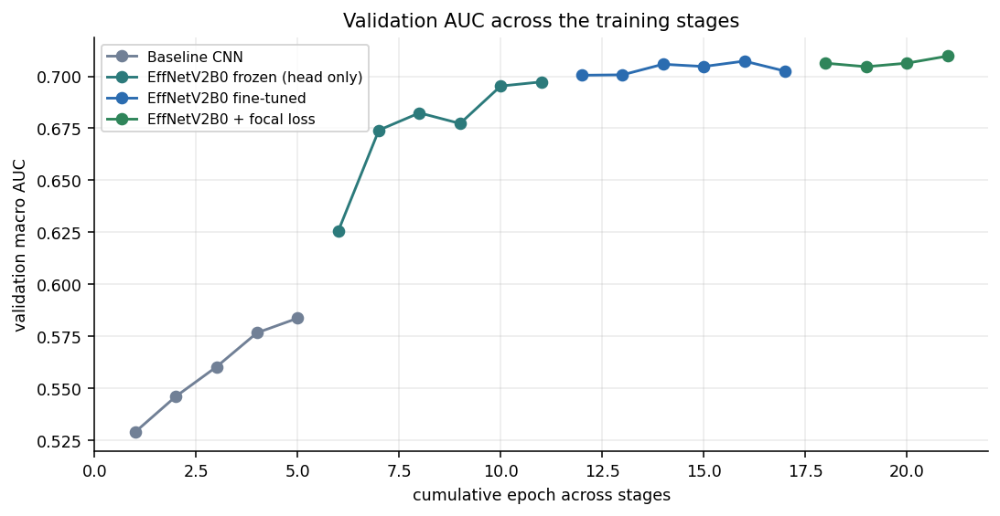 <em>Validation macro-AUC trajectory across the four training stages</em>

### fig_model_comparison.png

 <em>Comparison of the four main models on the test set</em>

### fig_per_disease_auc_ci.png

 <em>Per-disease ROC-AUC on the test set; error bars are approximate 95% confidence intervals</em>

### fig_ap_vs_prevalence.png

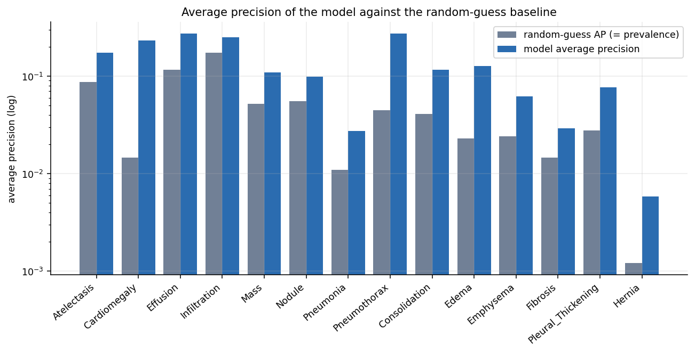 <em>Average precision (PR-AUC) versus the random-guess baseline per disease</em>

### fig_per_disease_prf.png

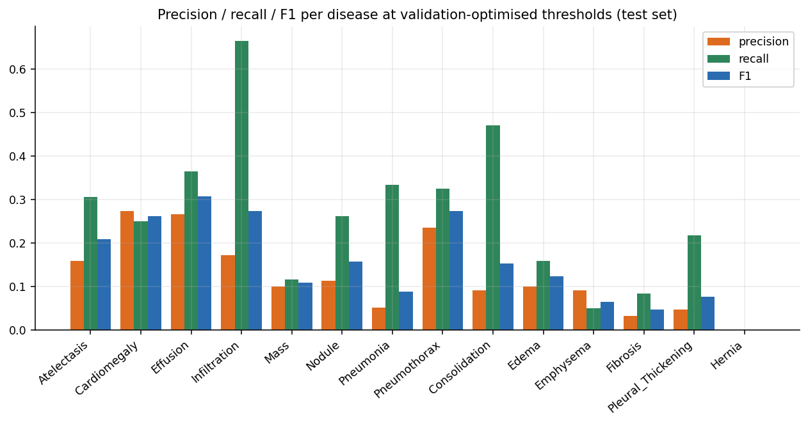 <em>Per-disease precision, recall and F1 on the test set after threshold optimisation</em>

### fig_thresholds_f1.png

 <em>Selected per-disease thresholds and their effect on test F1</em>

### fig_confusion_grid.png

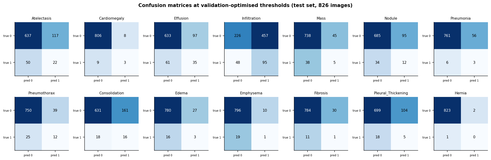 <em>Per-disease confusion matrices (counts) at the optimised thresholds</em>

### fig_error_breakdown.png

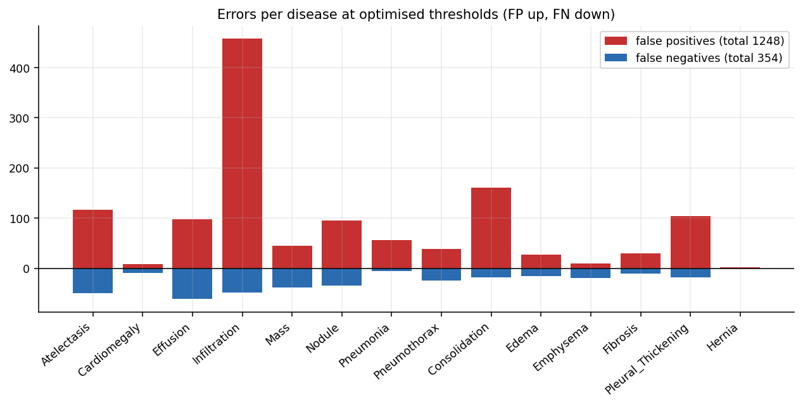 <em>False positives and false negatives per disease</em>

### fig_ablation.png

 <em>Innovation ablation: effect of ASL, deeper fine-tuning and the two-backbone ensemble</em>

### fig_ablation_val_auc.png

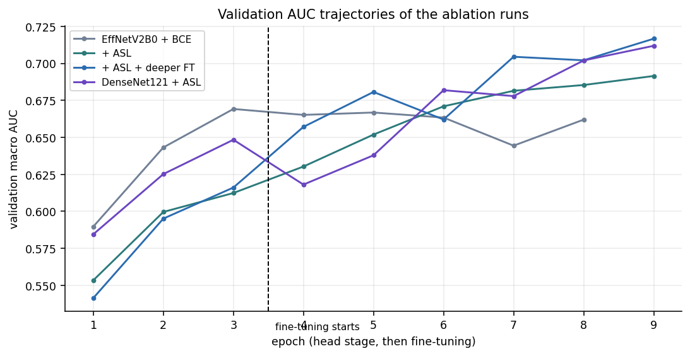 <em>Validation AUC trajectories of the ablation runs</em>

### fig_sota_per_class.png

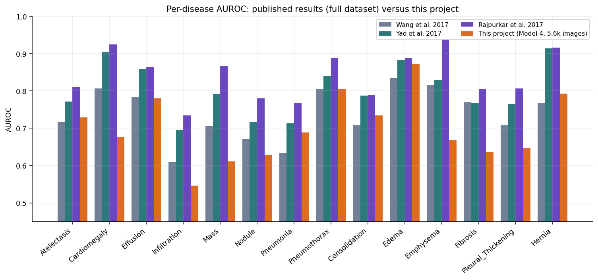 <em>Per-class AUROC of three published methods and of this project</em>

### fig_sota_means.png

 <em>Mean AUROC of published methods and this project</em>

### fig_gap_to_chexnet.png

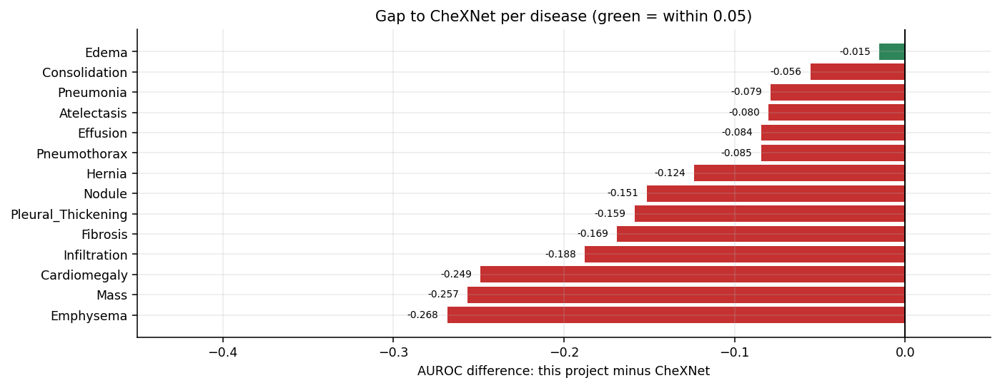 <em>Per-disease AUROC difference between this project and CheXNet</em>

### fig_errors_tta.png

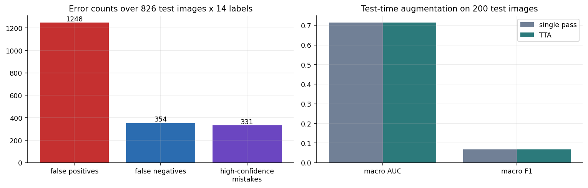 <em>Error totals and the test-time-augmentation comparison</em>

