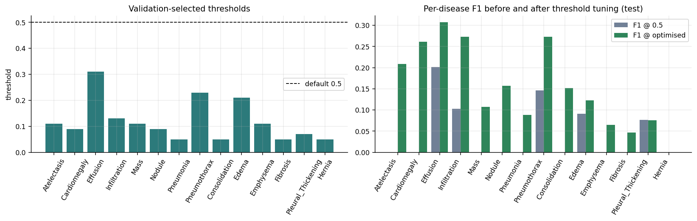

# Project report: Multi-Label Chest X-Ray Disease Classification Using EfficientNetV2, Transfer Learning, Fine-Tuning and Explainable AI

**Author:** Shhorya Agarwal (2430010318) - **Programme:** Manipal University Jaipur (MUJ) - B.Tech Data Science - Batch F capstone / project training programme (GitHub-based submission)

## Abstract

Automated reading of chest radiographs is a multi-label problem: one image can show several of 14 thoracic findings or none. We train four models on a patient-level split of a 5,606-image sample of the NIH ChestX-ray14 dataset - a from-scratch CNN, a frozen EfficientNetV2B0, the fine-tuned network and a fine-tuned network trained with focal loss - and select decision thresholds per disease on the validation split. The final model reaches a test macro ROC-AUC of **0.7012** (micro 0.7974) and a macro F1 of **0.1526** after threshold tuning. Transfer learning raises the macro AUC by +0.0918 over the scratch CNN. An ablation of asymmetric loss, deeper fine-tuning and a DenseNet121 + EfficientNetV2B0 ensemble shows that only the ensemble helps (12-class macro AUC 0.7312 vs 0.6955). Compared with CheXNet (mean AUROC 0.8414, full dataset) the final model is 0.1402 lower, which we attribute mainly - but without having isolated it experimentally - to the roughly twenty-fold smaller training set. Grad-CAM, error analysis, calibration and test-time augmentation complete the study.

## 1. Introduction

Chest X-ray is the most common imaging examination and its interpretation is a bottleneck. The NIH ChestX-ray14 collection (112,120 frontal radiographs, 30,805 patients, 14 labels mined from reports) made large-scale deep learning possible; CheXNet reached a mean AUROC of 0.8414 with a DenseNet-121. This project asks: *how much of that performance can a modern, small pre-trained network recover with a 5.6k-image sample on a free GPU, and which design choices matter?* The contribution is a careful, leakage-free and honest evaluation rather than a new state-of-the-art claim.

## 2. Related work

* **Benchmarks.** Wang et al. (2017) released the data and a ResNet-50 baseline (mean AUROC about 0.74). Yao et al. (2017) modelled label dependencies with an LSTM over DenseNet features (about 0.80). Rajpurkar et al. (2017, CheXNet) fine-tuned a 121-layer DenseNet and reported 0.8414.
* **Backbones.** EfficientNetV2 (Tan and Le, 2021) uses compound scaling and fused-MBConv blocks for fast, parameter-efficient training; DenseNet (Huang et al., 2017) reuses features through dense connections.
* **Imbalanced multi-label losses.** Focal loss (Lin et al., 2017) and asymmetric loss (Ridnik et al., 2021) down-weight easy negatives.
* **Explainability and calibration.** Grad-CAM (Selvaraju et al., 2017) and reliability analysis (Guo et al., 2017).

## 3. Data

| Split | Images | Patients | Share of images |
| :--- | ---: | ---: | ---: |
| train | 3931 | 2961 | 70.1% |
| val | 849 | 634 | 15.1% |
| test | 826 | 635 | 14.7% |
| **total** | 5606 | 4230 | 100% |

| Disease | Train + | Val + | Test + | Total + | Prevalence | Neg : pos (train) |
| :--- | ---: | ---: | ---: | ---: | ---: | ---: |
| Atelectasis | 364 | 72 | 72 | 508 | 9.06% | 9.8 |
| Cardiomegaly | 110 | 19 | 12 | 141 | 2.52% | 34.7 |
| Effusion | 459 | 89 | 96 | 644 | 11.49% | 7.6 |
| Infiltration | 674 | 150 | 143 | 967 | 17.25% | 4.8 |
| Mass | 195 | 46 | 43 | 284 | 5.07% | 19.2 |
| Nodule | 211 | 56 | 46 | 313 | 5.58% | 17.6 |
| Pneumonia | 43 | 10 | 9 | 62 | 1.11% | 90.4 |
| Pneumothorax | 193 | 41 | 37 | 271 | 4.83% | 19.4 |
| Consolidation | 161 | 31 | 34 | 226 | 4.03% | 23.4 |
| Edema | 83 | 16 | 19 | 118 | 2.10% | 46.4 |
| Emphysema | 88 | 19 | 20 | 127 | 2.27% | 43.7 |
| Fibrosis | 57 | 15 | 12 | 84 | 1.50% | 68.0 |
| Pleural_Thickening | 115 | 38 | 23 | 176 | 3.14% | 33.2 |
| Hernia | 10 | 2 | 1 | 13 | 0.23% | 392.1 |

## 4. Method

1. Patient-level split 70/15/15; images resized to 224 x 224; mild augmentation (no flips).
2. Models 1-4 as in the [methodology](METHODOLOGY.md): baseline CNN; EfficientNetV2B0 with frozen backbone; fine-tuning of the top 30% with cosine learning-rate decay; focal loss (gamma 2, alpha 0.25).
3. Per-disease thresholds selected on validation (F1), then frozen.
4. Evaluation on the untouched test split with ROC-AUC (macro, micro, per disease with Hanley-McNeil intervals), average precision, F1, precision, recall, confusion counts.
5. Grad-CAM, error analysis, TTA and calibration diagnostics.
6. Innovation ablation (A: ASL, B: deeper fine-tuning, C: two-backbone ensemble).

 split -> models -> thresholds -> evaluation -> explainability"> <em>End-to-end pipeline: data -> split -> models -> thresholds -> evaluation -> explainability</em>

## 5. Results

### 5.1 Model comparison

| Model | Subset acc. | Macro prec. | Macro recall | Macro F1 | Micro F1 | Macro ROC-AUC | Train time (s) |
| :--- | ---: | ---: | ---: | ---: | ---: | ---: | ---: |
| Model 1: Baseline CNN (scratch) | 0.5630 | 0.0000 | 0.0000 | 0.0000 | 0.0000 | 0.5934 | 667.5 |
| Model 2: EfficientNetV2B0 transfer (frozen) | 0.5375 | 0.1248 | 0.0211 | 0.0317 | 0.0973 | 0.6852 | 744.4 |
| Model 3: EfficientNetV2B0 fine-tuned | 0.5339 | 0.1205 | 0.0225 | 0.0339 | 0.0964 | 0.6871 | 759.4 |
| Model 4: EfficientNetV2B0 fine-tuned + focal loss | 0.5496 | 0.1721 | 0.0271 | 0.0442 | 0.0848 | 0.7012 | 497.1 |

 <em>Comparison of the four main models on the test set</em>

### 5.2 Final model, per disease

| Disease | ROC-AUC | 95% CI (approx.) | Test + | Avg. precision | Random AP | AP lift |
| :--- | ---: | ---: | ---: | ---: | ---: | ---: |
| Edema | 0.8726 | 0.770 - 0.975 | 19 | 0.1265 | 0.0230 | 5.5x |
| Pneumothorax | 0.8041 | 0.718 - 0.890 | 37 | 0.2740 | 0.0448 | 6.1x |
| Hernia | 0.7927 | 0.264 - 1.000 | 1 | 0.0058 | 0.0012 | 4.8x |
| Effusion | 0.7796 | 0.723 - 0.836 | 96 | 0.2745 | 0.1162 | 2.4x |
| Consolidation | 0.7344 | 0.637 - 0.832 | 34 | 0.1157 | 0.0412 | 2.8x |
| Atelectasis | 0.7293 | 0.661 - 0.798 | 72 | 0.1736 | 0.0872 | 2.0x |
| Pneumonia | 0.6890 | 0.495 - 0.883 | 9 | 0.0275 | 0.0109 | 2.5x |
| Cardiomegaly | 0.6760 | 0.507 - 0.845 | 12 | 0.2336 | 0.0145 | 16.1x |
| Emphysema | 0.6686 | 0.537 - 0.800 | 20 | 0.0617 | 0.0242 | 2.5x |
| Pleural_Thickening | 0.6476 | 0.524 - 0.771 | 23 | 0.0765 | 0.0278 | 2.7x |
| Fibrosis | 0.6356 | 0.465 - 0.806 | 12 | 0.0291 | 0.0145 | 2.0x |
| Nodule | 0.6288 | 0.540 - 0.717 | 46 | 0.0991 | 0.0557 | 1.8x |
| Mass | 0.6110 | 0.519 - 0.703 | 43 | 0.1093 | 0.0521 | 2.1x |
| Infiltration | 0.5467 | 0.494 - 0.600 | 143 | 0.2515 | 0.1731 | 1.5x |
| **macro mean** | 0.7012 | - | 40.5 | 0.1327 | - | - |

 <em>Per-disease ROC-AUC on the test set; error bars are approximate 95% confidence intervals</em>

### 5.3 Threshold optimisation

Macro F1 increases from 0.0442 to 0.1526 and micro F1 from 0.0848 to 0.2101 (test), at the price of a lower macro precision (0.1721 -> 0.1233) and a much higher macro recall (0.0271 -> 0.2570).

 <em>Selected per-disease thresholds and their effect on test F1</em>

### 5.4 Innovation ablation

| Experiment | A: ASL | B: deep FT | C: ensemble | Macro AUC (12 cls) | Macro F1 | Micro F1 | Trainable params | Total params | Min |
| :--- | :---: | :---: | :---: | ---: | ---: | ---: | ---: | ---: | ---: |
| EffNetV2B0 + BCE, 30% unfrozen (reference) | - | - | - | 0.6955 | 0.1361 | 0.2272 | 3,088,894 | 5,942,366 | 16.6 |
| +A  asymmetric loss (ASL) | yes | - | - | 0.6972 | 0.1309 | 0.1804 | 3,088,894 | 5,942,366 | 20.5 |
| +A+B  deeper fine-tuning (60% unfrozen) | yes | yes | - | 0.6958 | 0.1596 | 0.2125 | 4,970,030 | 5,942,366 | 19.4 |
| DenseNet121 + ASL (60% unfrozen) | yes | yes | - | 0.7180 | 0.1810 | 0.2041 | 5,169,166 | 7,055,950 | 27.5 |
| +A+B+C  proposed: EffNetV2B0 + DenseNet121 ensemble | yes | yes | yes | 0.7312 | 0.1843 | 0.2201 | 10,139,196 | 12,998,316 | 46.9 |

 <em>Innovation ablation: effect of ASL, deeper fine-tuning and the two-backbone ensemble</em>

### 5.5 Comparison with the literature

| Method | Training data | Classes scored | Mean AUROC (14) | Mean AUROC (12) |
| :--- | ---: | ---: | ---: | ---: |
| Wang et al. 2017 (ChestX-ray8, ResNet-50) | full 112,120 images | 14 / 14 | 0.7381 | 0.7445 |
| Yao et al. 2017 (DenseNet + LSTM) | full 112,120 images | 14 / 14 | 0.8027 | 0.8009 |
| Rajpurkar et al. 2017 (CheXNet, DenseNet-121) | full 112,120 images | 14 / 14 | 0.8414 | 0.8412 |
| This project - Model 4 (single model, saved) | 5,606-image sample | 14 / 14 | 0.7012 | 0.6945 |
| This project - proposed ensemble (CO5 experiment) | 5,606-image sample | 12 (>=10 test +) | - | 0.7312 |

 <em>Mean AUROC of published methods and this project</em>

### 5.6 Explainability

 <em>Grad-CAM heat-maps on test images, target = top predicted class (cell 24)</em>

## 6. Discussion

* Transfer learning is the dominant factor (+0.092 AUC); fine-tuning and focal loss add little (+0.002 and +0.014).
* Accuracy is uninformative here: predicting nothing scores 0.563 subset accuracy.
* AUC is significantly above 0.5 for Edema, Pneumothorax, Effusion, Consolidation, Atelectasis, Cardiomegaly, Emphysema, Pleural_Thickening, Nodule and Mass; for Hernia, Pneumonia, Fibrosis and Infiltration it is not distinguishable from chance on this test set.
* The ensemble gain (+0.0357 AUC) comes from a single seed and doubles the cost.

## 7. Conclusion

Transfer learning, patient-level evaluation and validation-based thresholds give a measurable and honestly quantified result (macro AUC 0.70, macro F1 0.15). The ensemble experiment indicates that architectural diversity helps more than loss engineering at this data scale. The distance to CheXNet (0.1402 AUROC) shows that data volume and resolution remain decisive; the first step of future work is therefore to train on the full dataset with cross-validation. The system is an educational prototype and not a diagnostic tool.

## References

1. Wang X., Peng Y., Lu L., Lu Z., Bagheri M., Summers R. M. *ChestX-ray8: Hospital-scale chest X-ray database and benchmarks on weakly-supervised classification and localization of common thorax diseases.* CVPR 2017.
2. Rajpurkar P. et al. *CheXNet: Radiologist-level pneumonia detection on chest X-rays with deep learning.* arXiv:1711.05225, 2017.
3. Yao L., Poblenz E., Dagunts D., Covington B., Bernard D., Lyman K. *Learning to diagnose from scratch by exploiting dependencies among labels.* arXiv:1710.10501, 2017.
4. Tan M., Le Q. V. *EfficientNetV2: Smaller models and faster training.* ICML 2021 (arXiv:2104.00298).
5. Huang G., Liu Z., van der Maaten L., Weinberger K. Q. *Densely connected convolutional networks.* CVPR 2017.
6. Lin T.-Y., Goyal P., Girshick R., He K., Dollar P. *Focal loss for dense object detection.* ICCV 2017.
7. Ridnik T. et al. *Asymmetric loss for multi-label classification.* ICCV 2021.
8. Selvaraju R. R. et al. *Grad-CAM: Visual explanations from deep networks via gradient-based localization.* ICCV 2017.
9. Guo C., Pleiss G., Sun Y., Weinberger K. Q. *On calibration of modern neural networks.* ICML 2017.
10. Hanley J. A., McNeil B. J. *The meaning and use of the area under a receiver operating characteristic (ROC) curve.* Radiology 143(1), 1982.
11. NIH Clinical Center. *ChestX-ray14 / NIH Chest X-rays* (Kaggle datasets `nih-chest-xrays/data` and `nih-chest-xrays/sample`).
12. Abadi M. et al. *TensorFlow: Large-scale machine learning on heterogeneous systems*; Chollet F. et al. *Keras*.
